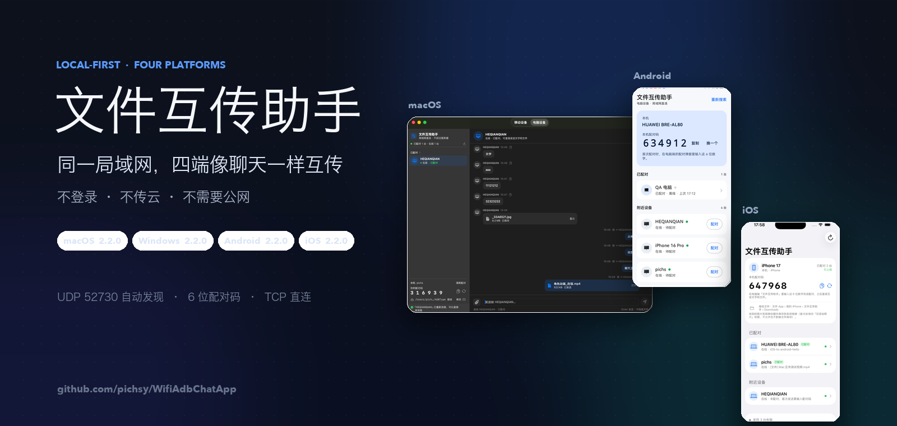
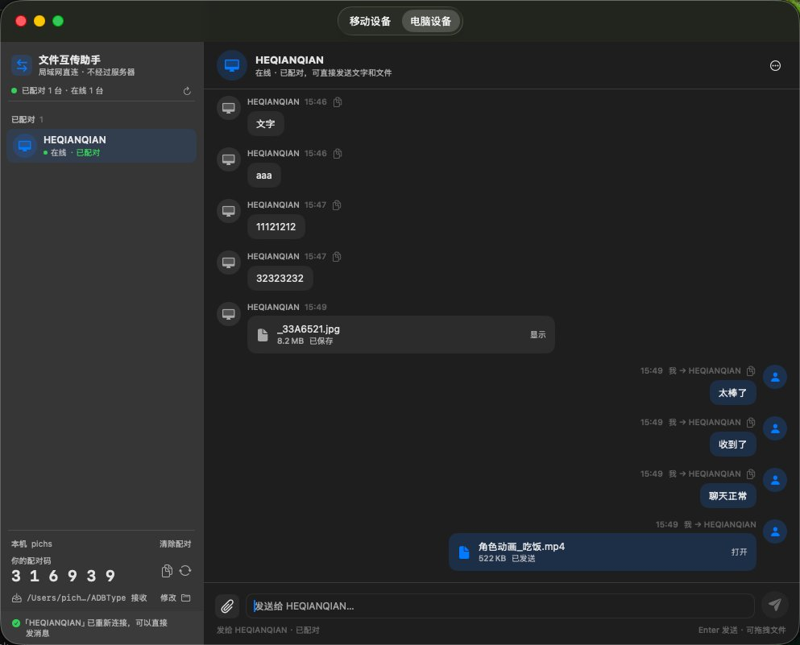
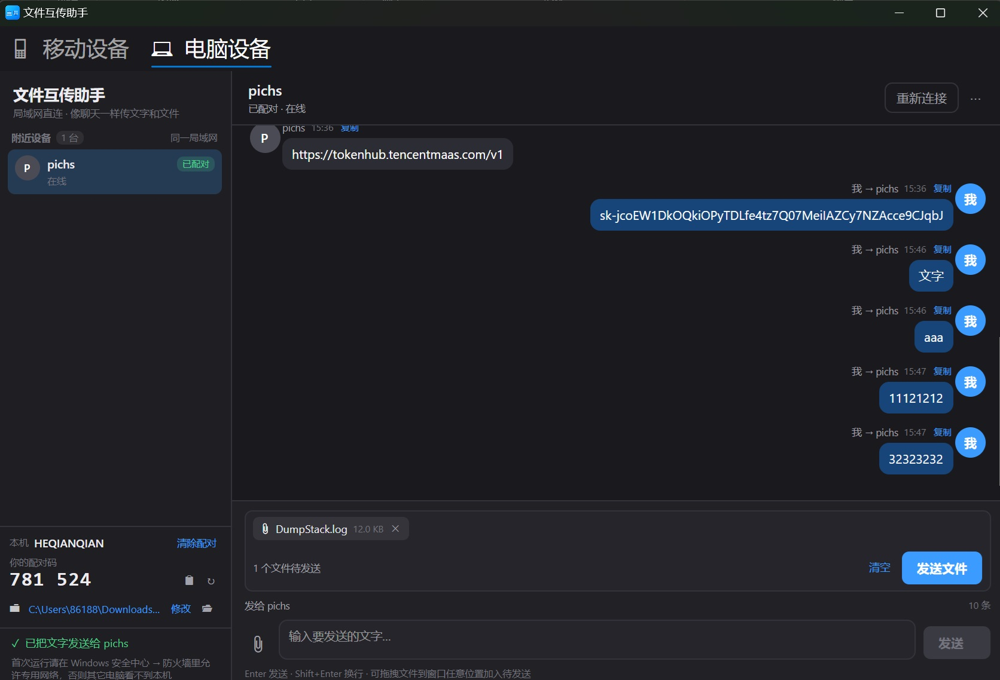
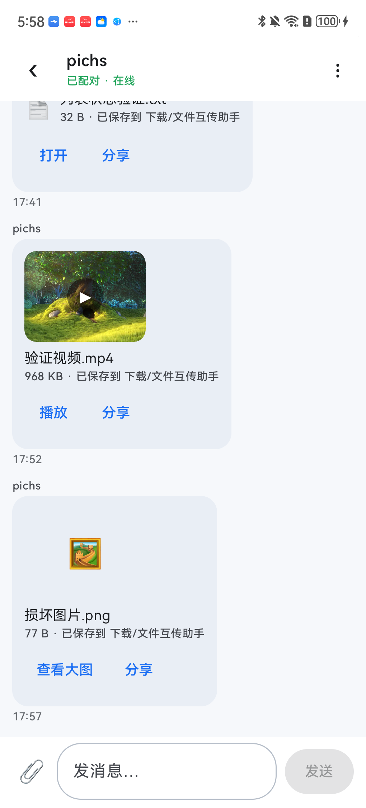
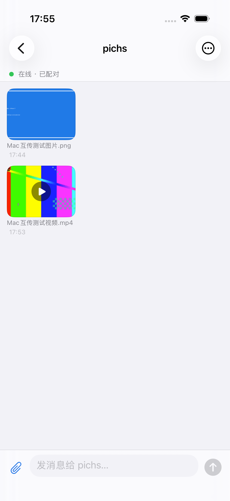
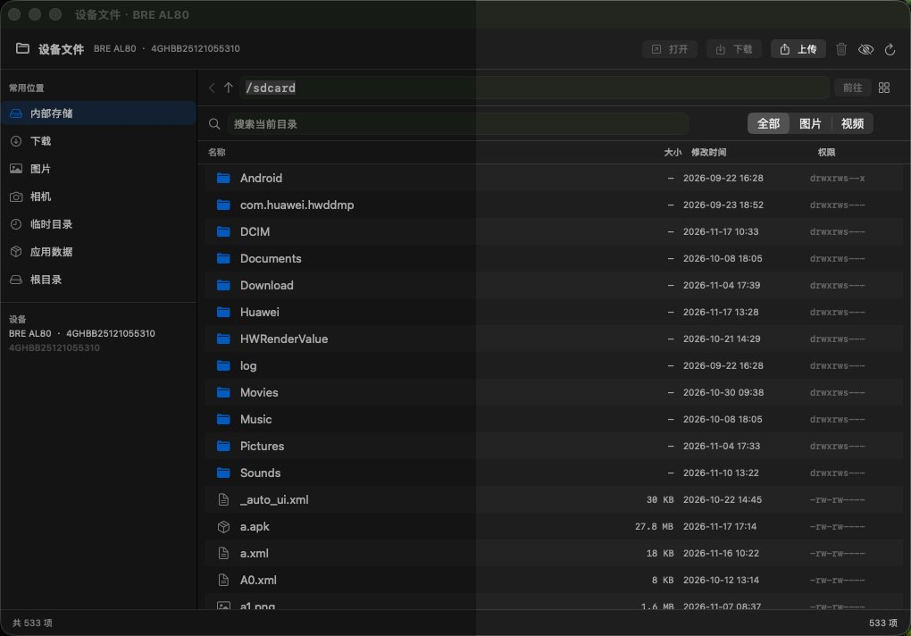
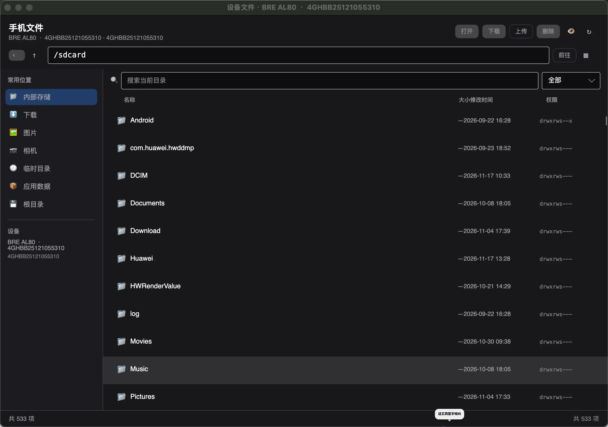
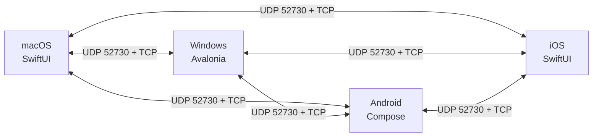

<div align="center">



<br />

<a href="https://github.com/pichsy/WifiAdbChatApp/releases/tag/v2.4.0">
  
</a>


<h3>不登录 · 不传云 · 同一 Wi-Fi 直接互传</h3>

<p>
  macOS / Windows / Android / iOS 四端原生 App。<br />
  自动发现、6 位配对码、像微信一样收发文字和文件；数据不经过服务器。
</p>

</div>

> **一句话**：把「就在旁边，却要经过微信 / 网盘 / U 盘」的文字和文件，变成同一局域网内的直连传输。
>
> **适合**：办公室电脑互传、Mac ↔ 手机、Windows ↔ 手机、临时给同事发安装包、在没有外网的环境传文件。
>
> **不适合**：公网穿透、跨网络远距离传输、需要端到端加密的敏感数据。

---

## 🚀 为什么是它

| 零服务器 | 四端原生 | 文件可控 |
| --- | --- | --- |
| UDP 52730 自动发现，TCP 直连；不登录、不上传云端、不需要公网。 | macOS（SwiftUI）、Windows（Avalonia）、Android（Compose）、iOS（SwiftUI），同一套协议和缓存。 | 进度百分比、取消、重名编号、半截文件清理；接收文件放在用户能直接找到的目录。 |

| 断线自愈 | 每设备独立会话 | 手机也能直接收 |
| --- | --- | --- |
| 2 秒心跳 + 已知设备单播 + 自动重连；网络切换 / 睡眠唤醒后恢复。 | 按设备 ID 存 `chats/<设备ID>.json`，离线 / 重启后历史还在；清空只影响当前会话。 | Android 存公共「下载/文件互传助手」，iOS 存「文件」App 的 Downloads，图片 / 视频还可进相册。 |

---

## 🖥️ 平台与状态

| 平台 | 版本 | 状态 | 安装包 |
| --- | --- | --- | --- |
| macOS 13+ | **2.4.0** | 电脑互传 + USB ADB 手机输入 / 文件 / 截屏；文件窗口支持当前目录搜索、类型过滤、列表/网格、缩略图和多选 | [dmg](https://github.com/pichsy/WifiAdbChatApp/releases/download/v2.4.0/WifiAdbChatApp-2.4.0.dmg) · [zip](https://github.com/pichsy/WifiAdbChatApp/releases/download/v2.4.0/WifiAdbChatApp-2.4.0-macOS.zip) |
| Windows 10 1809+ / 11 x64 | **2.4.0** | 电脑互传 + 移动设备截屏 + 手机文件管理（搜索/过滤）；居中胶囊页签 + 圆角窗口 | [安装包](https://github.com/pichsy/WifiAdbChatApp/releases/download/v2.4.0/WifiAdbChatApp-2.4.0-Windows-Setup.exe) |
| Android 8.0+（API 28） | **2.2.0** | 只做电脑互传；公共下载落盘 / 图片视频预览 | [APK](https://github.com/pichsy/WifiAdbChatApp/releases/download/v2.2.0/WifiAdbChatApp-Android-2.2.0.apk) |
| iOS 17+ | **2.2.0** | 只做电脑互传；Files 可见 Downloads / 相册 / AVKit | [IPA](https://github.com/pichsy/WifiAdbChatApp/releases/download/v2.2.0/WifiAdbChatApp-iOS-2.2.0-unsigned.ipa) |

> Android / iOS 端**不做** ADB、USB 调试、手机输入、移动设备页——只和电脑互传。
> iOS IPA 未签名；Android APK 已用项目 release key 签名。详见[下载说明](#-下载)。

---

## 📸 界面预览

| macOS · 电脑设备 | Windows · 电脑设备 |
| --- | --- |
|  |  |

| Android · 聊天缩略图 | iOS · 聊天缩略图 |
| --- | --- |
|  |  |

Windows 端会保留离线好友并显示「连接中断，正在重连…」：[离线好友截图](docs/screenshots/win-pc2.jpg)。
更多手机截图见 [Android README](mobile/android/README.md)、[iOS README](mobile/ios/README.md)。

---

## ✨ 核心能力

| 能力 | 说明 |
| --- | --- |
| **发现 / 配对** | UDP 52730 广播 + 已知设备单播；6 位配对码，配对后持久化设备 ID。 |
| **文字聊天** | 左收右发、时间、复制、自动滚底；中文 / emoji 正常。 |
| **文件传输** | 多文件选择 / 拖拽 / 粘贴；256 KiB 分块流式传输，进度、取消、失败清理。 |
| **手机接收位置** | Android 公共 `Download/文件互传助手/`；iOS `Documents/Downloads/`（Files App 可见）+ 图片 / 视频存相册。 |
| **ADB 手机管理** | 文件窗口：当前目录模糊搜索 + 全部/图片/视频过滤、列表/网格、缩略图、多选、右键、上传下载、批量删除、/data/data；移动设备页：文件推送与 ADB 截屏。完整说明见 [ADB 文件 / 传输 / 截屏](docs/adb-file-transfer-screenshot.md)。 |
| **图片 / 视频** | 120×90 缩略图，点击全屏缩放 / 播放；Android 用 filepicker，iOS 用 AVKit。 |
| **多设备会话** | 每设备独立缓存、好友列表、离线保留、别名、手动 / 自动重连。 |
| **桌面增强** | macOS 关闭 = 最小化到 Dock；Windows 关闭 = 收进托盘；Windows 移动设备页支持 ADB 截屏。 |
| **错误处理** | 连接 6s / 读写 30s 超时；对端退出、Wi-Fi 断开、端口占用都有中文提示，不崩溃。 |

## 📱 ADB 手机管理（文件 / 传输 / 截屏）

macOS / Windows 通过 USB 连接 Android 手机后，可以直接浏览手机文件、上传下载、截取手机屏幕；
手机端**不需要安装任何 App**，全部通过 adb 完成。iOS 端不提供 ADB 功能。

| 通道 | 入口 | 方向 | 适合 |
| --- | --- | --- | --- |
| **ADB 文件管理** | 移动设备 → 设备卡片「文件」 | 手机 ↔ 电脑 | 浏览目录、搜索过滤、上传下载、新建/删除、批量操作 |
| **快速文件推送** | 移动设备 →「待发送列表」 | 电脑 → 手机 | 把几个文件快速传到手机默认目录 |
| **ADB 截屏** | 移动设备 → 设备卡片「截屏」 | 手机 → 电脑 | 抓取手机当前屏幕，预览并保存 PNG |

<p align="center">
  
  
</p>

### 连接准备

1. 手机打开「开发者选项 → USB 调试」；
2. 数据线连接电脑，手机弹窗点「允许 USB 调试」并勾选「始终允许」；
3. 在终端执行 `adb devices -l`，看到状态为 `device` 才能操作；
4. 多台手机同时连接时，App 按设备序列号区分，各开一个文件窗口。

`unauthorized` 表示手机还没授权，`offline` 表示连接异常；重新插拔或在 App 里点「重启 adb」。
QtScrcpy、模拟器等工具占用 5037 端口时，`adb devices` 可能正常但 `adb shell` 卡死，
用 App 的「重启 adb」或执行 `adb kill-server && adb start-server` 修复。

### 文件管理窗口

设备卡片点「文件」打开独立窗口，macOS / Windows 功能一致：

- **左侧常用位置**：内部存储、下载、图片、相机、临时目录、应用数据、根目录；
- **路径栏**：返回、上一级、输入路径后「前往」；输入精确文件路径时进入父目录并选中文件，不直接打开；
- **只允许手机路径**：输入 Mac / Windows 本机路径会被拦截，`..` 不能跳出预期目录；
- **根目录保护**：隐藏 `bin`、`d`、`etc`、`cache`、`init` 等系统软链和不可访问项；
- **软链接**：先解析目标，目标是目录才跳转，是文件才下载；
- **列表字段**：名称、大小、修改时间、权限；文件夹排在文件前面，隐藏文件可切换显示；
- **搜索**：只搜索当前目录，支持不区分大小写的包含匹配和字符顺序模糊匹配，不递归子目录；
- **类型过滤**：全部 / 图片 / 视频，与搜索叠加；图片/视频模式只显示对应文件；
- **列表 / 网格**：网格卡片等宽等高、文件名单行中间省略；
- **缩略图**：图片、GIF、视频异步加载缩略图，macOS 用 ImageIO / AVFoundation，
  Windows 用 Avalonia + Windows Shell；其它文件显示图标。

#### 选择与右键规则

| 操作 | macOS | Windows |
| --- | --- | --- |
| 单选 | 单击 | 单击 |
| 多选 | `Command` + 单击 | `Ctrl` + 单击 |
| 连选 | `Shift` + 单击 | `Shift` + 单击 |
| 在已选行上右键 | 保留多选，新建/上传/打开置灰 | 同左 |
| 在未选行上右键 | 清空其它选择，只选中该行 | 同左 |

所有选中行显示蓝色背景；顶部「打开」只对单选项可用，「下载」「删除」对多选项生效。

#### 右键菜单与文件操作

| 菜单项 | 行为 |
| --- | --- |
| 新建 → 文件 / 文件夹 | 右键文件夹时建在该目录内，右键文件/空白时建在当前目录；成功后刷新并选中 |
| 上传到当前目录… | 选择文件上传；右键文件/空白时使用 |
| 上传到此文件夹… | 右键目录时直接把文件传进该目录；支持整个文件夹 |
| 打开文件夹 / 打开文件 | 文件夹进入；文件下载到临时目录并用默认 App 打开 |
| 下载到电脑… | 单个文件弹保存面板；多选/文件夹选目标目录，按原名保存，目录递归下载 |
| 复制路径 | 多选时每行一个路径，用换行符拼接后一次复制 |
| 刷新 | 重新读取当前目录，任何右键场景都有 |
| 删除… | 删除选中项；始终弹确认，文件夹会连同内容删除 |

下载支持单个文件、多个文件和整个文件夹；上传支持文件和文件夹。
上传/下载都有进度；单个下载可以在保存面板改名，多选下载保留手机上的原文件名。
同名文件上传按 adb 行为覆盖，不会自动加序号。

#### /data/data 应用数据

普通 adb shell 读不到应用私有目录时：

1. 先用 `pm list packages` 列出包名，生成可浏览的包目录；
2. debuggable 应用（例如本项目 Android 端）用 `run-as <包名> ls -la ...` 查看
   `files`、`shared_prefs`、`cache`；
3. 非 debuggable 应用只显示包名，进入提示权限不足；
4. 该区域**始终只读**，不能新建、上传、删除，避免误删应用数据。

这不是 root，不绕过 Android 权限模型。

### ADB 文件传输（快速推送）

移动设备页的「待发送列表」用于快速把文件传到手机：

- macOS：拖拽、选择文件、从剪贴板粘贴文件/图片/文本；Windows：文件选择器；
- 目标目录默认 `/sdcard/Download`，可编辑并持久化；
- 点「传到手机」后逐个执行 `adb push -p`，每项和整体都有百分比进度；
- 只接受单个文件，**不支持整个文件夹**；传文件夹请用文件窗口的上传；
- 文件名不变，同名文件按 adb 行为覆盖，不自动重命名；
- 某个文件失败不会回滚已成功的文件，失败项保留错误信息。

> 这是电脑 → 手机单向通道；手机 → 电脑请用文件窗口下载，或电脑设备聊天的文件消息。

### ADB 截屏

- 设备卡片点「截屏」，底层执行 `adb -s <serial> exec-out screencap -p`；
  使用 `exec-out` 而不是 `shell`，避免部分设备把换行转成 CRLF 损坏 PNG；
- 抓取后在独立可缩放窗口预览，可「刷新截屏」「保存截屏」「保存位置…」；
- 默认保存到系统「下载」目录，文件名 `截屏-yyyyMMdd-HHmmss.png`，同秒重名自动 `(2)`、`(3)`；
- macOS 支持触控板捏合缩放、双击、拖拽平移、1:1；Windows 支持滚轮缩放、拖拽、1:1；
- 保存成功显示 toast / 状态提示；Windows 可一键定位最近保存的文件夹；
- 截屏不经过云服务，不调用系统屏幕录制权限，全部由手机端 `screencap` 完成。

### macOS / Windows 差异

| 项目 | macOS | Windows |
| --- | --- | --- |
| 多选修饰键 | `Command` / `Shift` | `Ctrl` / `Shift` |
| 删除快捷键 | `⌘⌫` | 工具栏 / 右键菜单 |
| 缩略图 | ImageIO / AVFoundation | Avalonia + Windows Shell |
| 截屏缩放 | 触控板捏合 / 双击 / 拖拽 | 滚轮 / 拖拽 / 1:1 |
| 快速推送粘贴 | 文件 / 图片 / 文本 | 以文件选择器为主 |

ADB 命令速查：`adb devices -l`、`adb shell ls -la <path>`、`adb pull -p`、`adb push -p`、
`pm list packages`、`run-as <pkg> ls -la`、`exec-out screencap -p`。
删除/覆盖操作都有明确 UI 入口，删除必须确认；不会静默执行。

> 更细的逐项说明、每种错误处理、完整命令对照表和验收清单见
> [ADB 文件 / 传输 / 截屏完整说明](docs/adb-file-transfer-screenshot.md)。
---

## 🧠 架构



| 协议要点 | 值 |
| --- | --- |
| 发现 | UDP `52730`，2 秒广播 / 心跳，8 秒无心跳离线 |
| 传输 | TCP 随机端口，4 字节大端长度 + UTF-8 JSON |
| 单帧上限 | 16 MiB |
| 文件块 | 256 KiB 原始字节流 |
| 配对 | 6 位数字码，配对 ID 持久化 |
| 超时 | 连接 6s，读写 30s |

完整帧格式、握手、字段和验收清单见 [协议与界面规格](docs/LAN-transfer-spec.md)。

---

## ⚡ 快速开始

| 平台 | 最短路径 |
| --- | --- |
| **macOS** | `cd macos && ./build.sh` → 打开 `文件互传助手.app` |
| **Windows** | 从 [GitHub Release v2.4.0](https://github.com/pichsy/WifiAdbChatApp/releases/tag/v2.4.0) 下载安装包，或运行 `windows\build.ps1` |
| **Android** | `cd mobile/android && ./gradlew assembleDebug`，或直接安装 release APK |
| **iOS** | `cd mobile/ios && xcodegen generate`，再用 Xcode / `xcodebuild` 构建 |

使用前确认：

1. 两台设备连**同一个 Wi-Fi / 局域网**；
2. 电脑端允许「本地网络」（macOS）或防火墙「专用网络」（Windows）；
3. 首次发送时，在对方屏幕上读出 6 位配对码并输入；
4. 配对后直接在聊天里发文字 / 文件即可。

各平台构建、权限、模拟器 / 真机步骤：
[macOS](macos/README.md) · [Windows](windows/README.md) · [Android / iOS](mobile/README.md) · [协议测试](mobile/tests/README.md)

---

## 📦 下载

| 平台 | 文件 | 大小 | 说明 |
| --- | --- | --- | --- |
| macOS | [文件互传助手-2.4.0.dmg](https://github.com/pichsy/WifiAdbChatApp/releases/download/v2.4.0/WifiAdbChatApp-2.4.0.dmg) | 4.0 MB | 通用二进制（Apple 芯片 / Intel），未公证；另有 [zip](https://github.com/pichsy/WifiAdbChatApp/releases/download/v2.4.0/WifiAdbChatApp-2.4.0-macOS.zip) |
| Windows | [文件互传助手-2.4.0-安装包.exe](https://github.com/pichsy/WifiAdbChatApp/releases/download/v2.4.0/WifiAdbChatApp-2.4.0-Windows-Setup.exe) | 28.1 MB | 内置 .NET 8 运行时，含文件浏览窗口；详见 [Windows README](windows/README.md) |
| Android | [文件互传助手-Android-2.2.0.apk](https://github.com/pichsy/WifiAdbChatApp/releases/download/v2.2.0/WifiAdbChatApp-Android-2.2.0.apk) | 42 MB | release key 签名，可直接侧载 |
| iOS | [文件互传助手-iOS-2.2.0.ipa](https://github.com/pichsy/WifiAdbChatApp/releases/download/v2.2.0/WifiAdbChatApp-iOS-2.2.0-unsigned.ipa) | 2.2 MB | 未签名，需自己的 Team 重签 |

- 校验值：[`release/SHA256SUMS.txt`](release/SHA256SUMS.txt) · 安装细节：[`release/README.md`](release/README.md)
- GitHub Release：[v2.4.0](https://github.com/pichsy/WifiAdbChatApp/releases/tag/v2.4.0)（macOS / Windows / Android / iOS 安装包与校验值）
- Android 如果装过旧 debug 签名版，需先 `adb uninstall dev.local.adbtype.mobile` 再安装新签名 APK。
- iOS 首次运行需允许「本地网络」；图片 / 视频首次保存到相册会询问「仅添加照片」。

---

## 📚 文档地图

| 想了解 | 文档 |
| --- | --- |
| 5 分钟了解项目 / 选平台 | [文档中心](docs/README.md) |
| 产品能力、架构、实测数据 | [产品与技术](docs/product-and-tech.md) |
| 帧格式、握手、字段、验收 | [协议与界面规格](docs/LAN-transfer-spec.md) |
| ADB 文件管理 / 传输 / 截屏 / 排错 | [ADB 手机管理完整说明](docs/adb-file-transfer-screenshot.md) |
| macOS 构建 / 打包 / 限制 | [macOS README](macos/README.md) |
| Windows 构建 / 安装 / 防火墙 | [Windows README](windows/README.md) |
| Android / iOS 构建 / 权限 / 存储 | [移动端 README](mobile/README.md) |
| 协议参考对端 / 回归测试 | [mobile/tests](mobile/tests/README.md) |
| 2.4.0 更新内容（搜索 / 过滤） | [发布说明](docs/release-notes-2.4.0.md) |
| 2.3.0 更新内容 | [发布说明](docs/release-notes-2.3.0.md) |
| 2.2.0 更新内容 | [发布说明](docs/release-notes-2.2.0.md) |

---

## 🔒 安全与边界

- 局域网直连是**明文 TCP**，没有加密 / 身份校验，仅适合可信家庭、办公室或热点网络。
- 公司 / 酒店 Wi-Fi 常有 AP 隔离；两端互相搜不到时，换手机热点再试。
- iOS 进入后台会被系统挂起，接收消息需保持前台；Android 无前台服务，长时间后台可能收不到。
- macOS 未签名 / 未公证；Windows 安装包未做代码签名；iOS IPA 未签名。首次打开可能被系统安全提示拦截，按各端 README 放行。
- 公网穿透、跨网络、端到端加密不在本项目范围内。

---

## 🗂️ 仓库结构

<details>
<summary>展开目录</summary>

```text
.
├─ macos/                 macOS 端（SwiftUI + AppKit）
├─ windows/               Windows 端（Avalonia + .NET 8）
├─ mobile/
│  ├─ android/            Android（Kotlin + Compose）
│  ├─ ios/                iOS（SwiftUI）
│  ├─ tests/              Python 协议参考对端 + 回归测试
│  └─ README.md
├─ release/               发布说明 + SHA256SUMS（安装包在 GitHub Releases）
├─ docs/
│  ├─ README.md           文档中心
│  ├─ product-and-tech.md 产品 / 架构 / 实测
│  ├─ LAN-transfer-spec.md 协议 + 界面规格
│  └─ screenshots/        界面截图
├─ README.md
└─ .gitignore
```

</details>

> 改名说明：App 显示名统一为「文件互传助手」；内部 Bundle ID、可执行文件名和协议广播标识仍是 `ADBType` / `ADBTypeLink`，旧版本配对和聊天记录继续有效。

---

<div align="center">

**如果这个项目帮你省下了几次微信传文件，欢迎 Star ⭐**

[GitHub](https://github.com/pichsy/WifiAdbChatApp) · [Gitee](https://gitee.com/pichs/WifiAdbChatApp) · [Releases](https://github.com/pichsy/WifiAdbChatApp/releases)

<sub>最后更新：2026-11-15 · macOS / Windows v2.4.0 · Android / iOS v2.2.0</sub>

</div>
