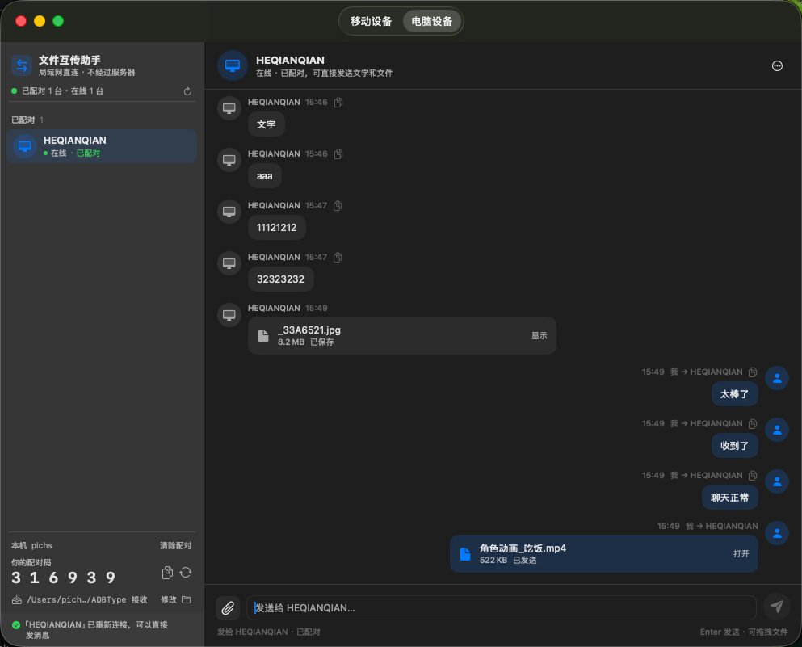
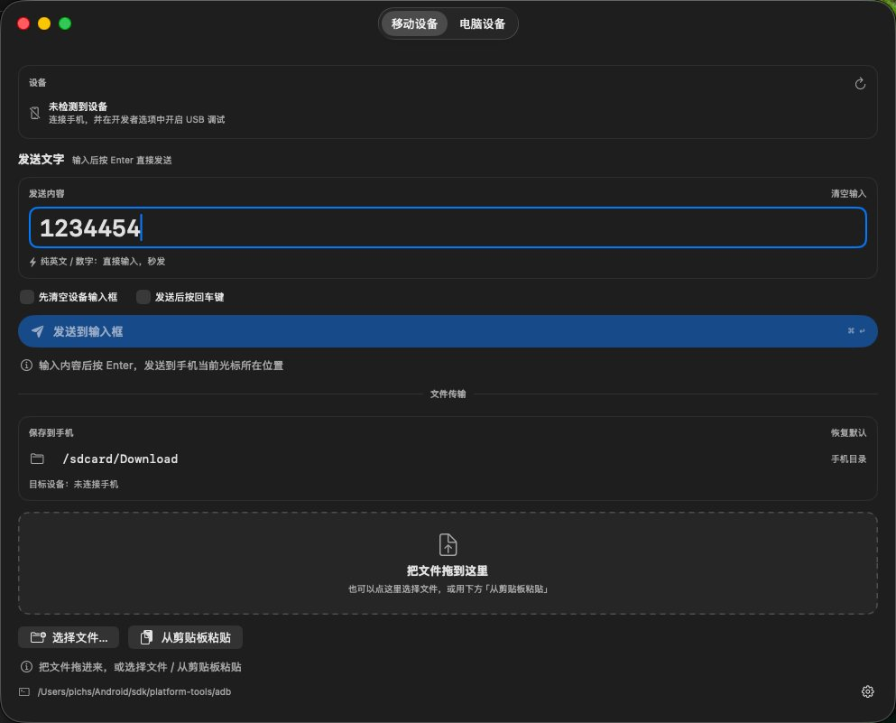
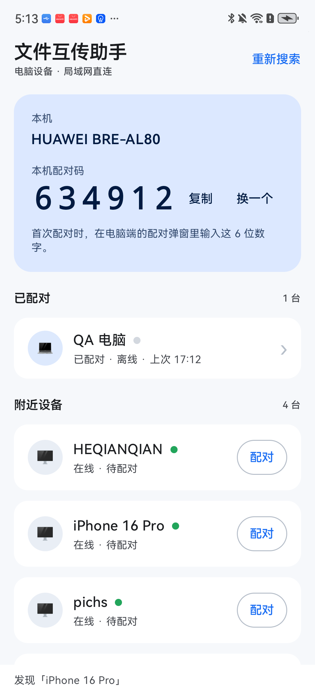
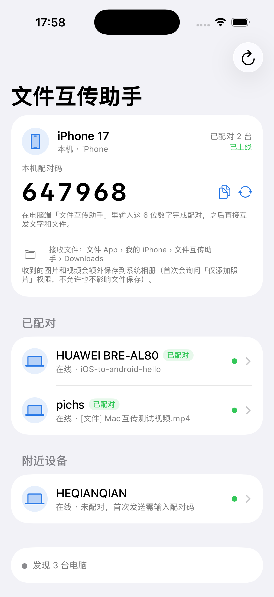
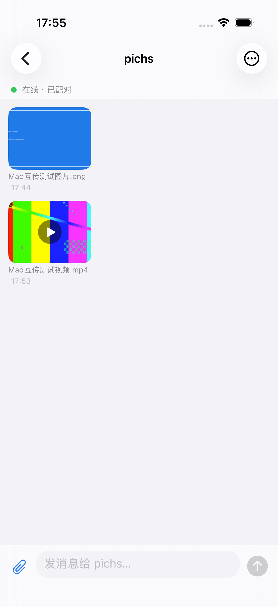

# 文件互传助手 · 局域网互传（macOS / Windows / 移动端规划）

一套局域网直连的小工具，按端分成独立目录，互不交叉：

- **macOS 端**（[`macos/`](macos/)）：SwiftUI 原生 App。既能用 adb 把文字/文件送到手机，也能和电脑像微信一样聊天互传。
- **Windows 端**（[`windows/`](windows/)）：Avalonia + .NET 8 桌面端，和 macOS 端同一套协议、同样的聊天界面。
- **移动端**（[`mobile/`](mobile/)）：规划中，目前只有 README。

电脑之间**直连传输，不经过服务器**：UDP 52730 发现设备，6 位配对码配对，之后用 TCP 收发
文字和文件；聊天记录、配对关系本地持久化。macOS 端会把已配对设备记成好友常驻左侧列表，
对方离线时保留并自动重连，也提供手动重连。

> 改名说明：App 的显示名称统一为「文件互传助手」。内部 Bundle ID、可执行文件名和协议广播
> 标识仍是 `ADBType` / `ADBTypeLink`，不影响与旧版本或其他端互传，已有配对和聊天记录继续有效。

---

## 仓库结构

```
.
├─ macos/                 macOS 端（源码、图标、打包脚本、联调工具）
│  ├─ Sources/            SwiftUI App 源码
│  ├─ Resources/          Info.plist、图标、手机剪贴板 dex
│  ├─ packaging/          分发用安装说明与安装脚本
│  ├─ tests/              协议探针 / 界面离屏渲染 / 互通测试
│  ├─ build.sh            编译出「文件互传助手.app」
│  └─ package.sh          生成 dmg / zip
├─ windows/               Windows 端（Avalonia + .NET 8）
│  ├─ src/                Core、App、SmokeTest、TestPeer
│  ├─ installer/          NSIS 安装包脚本（带安装向导 + 桌面快捷方式）
│  ├─ build.ps1           构建 + 发布
│  ├─ build-release.ps1   生成 release/ 下的安装包
│  └─ README.md           构建、使用、防火墙说明
├─ release/               正式发布包（macOS dmg + Windows 安装包）
├─ mobile/                移动端（Android / iOS 原生 App，只做电脑互传）
├─ docs/
│  ├─ product-and-tech.md    产品能力、核心技术与实测数据
│  ├─ LAN-transfer-spec.md   三端共用的协议 + 界面规格
│  └─ screenshots/           界面预览图
├─ README.md
└─ .gitignore
```

## 各端状态

| 端 | 状态 | 说明 |
| --- | --- | --- |
| macOS | ✅ 可运行 | 手机输入 / 手机文件传输 / 电脑聊天互传；已配对好友列表 + 别名 + 每设备独立会话 + 自动/手动重连 + 发送进度/取消 + 消息右键菜单/文件缺失删除线/关闭按钮最小化；已打包 2.0.1（dmg + zip） |
| Windows | ✅ 代码完成，安装包可用 | macOS 上编译 0 warning、冒烟测试 37/37 + 9/9、与 macOS 端双向真实收发通过；Windows 真机上安装 / 桌面快捷方式 / 卸载已验证；关闭窗口收进托盘，后台继续收发 |
| Android | ✅ 原生已实现 | Kotlin + Compose，minSdk 28；只做电脑互传；公开 Downloads 落盘 + 图片/视频缩略图/filepicker 预览；HUAWEI 真机联调通过 |
| iOS | ✅ 原生已实现 | SwiftUI，iOS 17+；只做电脑互传；Documents/Downloads + 系统相册；缩略图/AVKit 播放；iPhone 17 模拟器 49 tests + UI 测试通过（真机需签名） |

## 界面预览

**macOS**

| 电脑设备 | 移动设备 |
| --- | --- |
|  |  |

**Windows**

| 电脑设备 | 移动设备 |
| --- | --- |
|  |  |

Windows 端同样会保留离线好友，并在状态栏显示「连接中断，正在重连…」：[离线好友截图](docs/screenshots/win-pc2.jpg)。

**Android / iOS**

| Android 首页 | Android 聊天（缩略图） |
| --- | --- |
|  |  |

| iOS 首页 | iOS 聊天（缩略图） |
| --- | --- |
|  |  |

## 核心技术与亮点

- **零服务器直连**：UDP 52730 自动发现，TCP 随机端口直接传文件；不登录、不上传云端、不需要公网。
- **自研轻量协议**：4 字节大端长度 + UTF-8 JSON 帧，支持 `hello / pair_required / text / file / ok / bye`，单帧上限 16 MiB，文件按 256 KiB 原始字节流式传输。
- **断线自愈**：2 秒心跳 + 已知设备单播 + 自动重连；设备掉线先标「离线 · 正在重连」，好友列表和聊天记录不消失；网络切换 / 睡眠唤醒自动恢复。
- **每设备独立会话**：按设备 ID 存 `chats/<设备ID>.json`，选中谁只显示谁；离线、重启后历史仍在；旧版单文件记录自动合并迁移。
- **文件传输可控**：进度百分比、X 取消、失败清理半截文件、重名自动编号；文件丢失显示删除线，右键可打开接收目录。
- **三端原生**：macOS 用 SwiftUI + AppKit 通用二进制；Windows 用 .NET 8 + Avalonia 自包含安装包；Android 用 Kotlin + Compose；iOS 用 SwiftUI + AVKit；同协议、同缓存格式，可混用。
- **移动端存储与预览**：Android 接收文件落公共 `Download/文件互传助手/`；iOS 落「文件」App 可见的 `Documents/Downloads/` 并支持存入相册；图片/视频 120×90 缩略图，点击放大 / 播放（Android 使用 filepicker 弹窗）。
- **手机直达**：USB ADB 注入中文 / ASCII 文字，文件直接推进 `/sdcard/Download`。

完整架构、核心技术和实测数据：[docs/product-and-tech.md](docs/product-and-tech.md)。

## 快速开始

**macOS**

```bash
cd macos
./build.sh          # 需要 Xcode 命令行工具；默认 arm64 + x86_64
open 文件互传助手.app
```

**Windows**

直接运行已打包好的安装程序：

```
release\文件互传助手-2.0.1-安装包.exe
```

安装向导最后一页默认勾选「创建桌面快捷方式」，完成后桌面 / 开始菜单即可启动。
从源码构建 / 重新打包见 [`windows/README.md`](windows/README.md)。

**Android / iOS**

```bash
cd mobile/android && ./gradlew assembleDebug   # APK: app/build/outputs/apk/debug/app-debug.apk
cd mobile/ios && xcodegen generate             # 然后用 Xcode / xcodebuild 构建
```

详细依赖、权限、模拟器/真机步骤见 [`mobile/README.md`](mobile/README.md)。

## 文档

- 产品能力、核心技术与实测数据：[`docs/product-and-tech.md`](docs/product-and-tech.md)
- 局域网协议 + 双端界面规格：[`docs/LAN-transfer-spec.md`](docs/LAN-transfer-spec.md)
- macOS 端构建、打包、使用、限制：[`macos/README.md`](macos/README.md)
- Windows 端构建、使用、防火墙：[`windows/README.md`](windows/README.md)
- Windows 真机测试清单：[`windows/TESTING.md`](windows/TESTING.md)
- macOS 联调工具（探针 / Python 对端 / 互通脚本）：[`macos/tests/README.md`](macos/tests/README.md)
- Android / iOS 原生 App：[`mobile/README.md`](mobile/README.md)
- 协议参考对端 / 回归测试：[`mobile/tests/README.md`](mobile/tests/README.md)

## 下载与安装包

**macOS 直接下载**：[`release/文件互传助手-2.0.1.dmg`](release/文件互传助手-2.0.1.dmg)
（3.4 MB，macOS 13+，Apple 芯片 / Intel 通用）

- 双击 dmg，把「文件互传助手.app」拖进「应用程序」覆盖旧版即可；
- 未签名 / 未公证，首次打开如被拦：右键「打开」，或执行 dmg 里的 `授权并安装.sh`；
- 历史版本与 SHA-256 见 [`release/README.md`](release/README.md)。

**Windows 直接下载**：[`release/文件互传助手-2.0.1-安装包.exe`](release/文件互传助手-2.0.1-安装包.exe)
（28.1 MB，Windows 10 1809+ / 11 x64）

- 带安装向导的安装程序，内置 .NET 运行时，目标机器无需安装 .NET；
- 点右上角 ✕ 只是把窗口收进**托盘**，后台继续收发；左键托盘图标恢复窗口，右键菜单可退出；
- 安装位置由你在向导里选择（默认 `D:\Program Files\文件互传助手`，向导里随时可以改），
  主程序、原生库、图标、卸载程序全部放在这个目录里，运行时直接从这里启动，<br>
  不会再往 `C:\...\Temp` 解压程序文件；
- **安装向导最后一页有「创建桌面快捷方式」勾选项，默认勾选**；点「完成」时才创建桌面快捷方式，
  取消勾选则只建开始菜单项；
- 聊天记录、配对信息和接收到的文件仍保存在用户数据目录（`%APPDATA%\ADBTypeLink` 等），不受安装位置影响；
- 安装 / 卸载 / 静默安装 / 防火墙说明见 [`release/安装说明.md`](release/安装说明.md)。

macOS 的构建产物仍由 `macos/package.sh` 生成在 `macos/dist/`（不进 git）；正式发布包放在 `release/`。
Windows 的自包含 exe 由 `windows/build-release.ps1` 生成到 `release/`（中间产物 `windows/publish/` 不进 git）：

```powershell
powershell -ExecutionPolicy Bypass -File windows\build-release.ps1
```

仅重新生成安装包（复用已发布的 exe）：加 `-SkipBuild`。

## 已知限制

- 局域网传输是明文直连，没有加密，仅适合可信的家庭 / 办公网络。
- 公司 / 酒店 Wi-Fi 常有 AP 隔离，两端互相搜不到时换手机热点再试。
- macOS 首次使用「电脑设备」页需要允许「本地网络」权限；Windows 首次运行需要放行防火墙的专用网络。
- Windows 安装包（安装 / 桌面快捷方式 / 静默安装 / 卸载）已在真实 Windows 机器上验证；应用界面细节、
  防火墙放行和双机互传仍建议按 [`windows/TESTING.md`](windows/TESTING.md) 点一遍。
