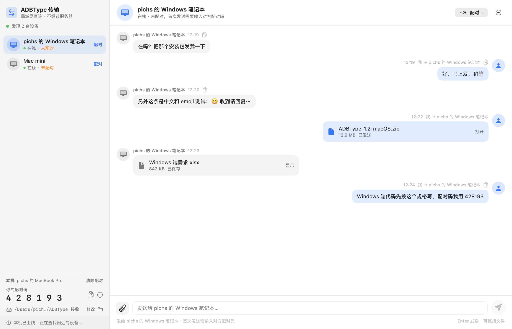
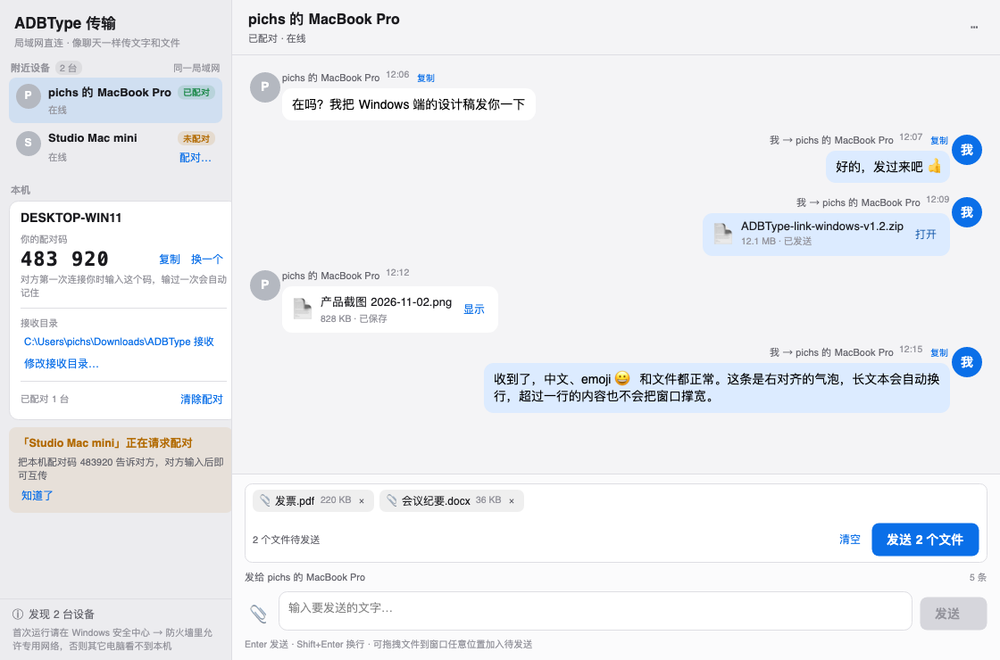

# ADB 输入 · macOS / Windows 局域网互传

一个原生小工具，两大用途：

1. **Mac 上输入内容，直接打进手机当前输入框**（「移动设备」页）
2. **Mac ↔ Windows/macOS 电脑之间，像微信一样聊天式收发文字和文件**（「电脑设备」页）

Windows 端是同一套协议的 Avalonia + .NET 8 客户端，源码在 [`windows/`](windows/)，
界面与 macOS 端一致。

## 界面预览

| macOS「电脑设备」页（深色 / 浅色） | Windows 端（深色 / 浅色） |
| --- | --- |
|  |  |
|  |  |

---

## 一、移动设备（手机输入）

在 Mac 上输入内容，按 Enter，直接打进**手机当前获得焦点的输入框**。两条路径自动切换：

- **纯英文 / 数字**：按钮显示「发送到输入框」，`adb shell input text <内容>`，秒发。
- **含中文 / emoji**：按钮显示「发送到设备剪贴板」。`input text` 敲不了中文，于是把文字写进
  手机系统剪贴板，再由你在手机上长按输入框点「粘贴」。不碰手机上的任何界面，不会误操作。

写手机剪贴板用的是随 App 内置的一个 2 KB dex（`adbtype-clip.jar`），以 shell 身份
`app_process` 运行并调用系统 `IClipboard`。手机端不用装任何 App，也不用切输入法。

「移动设备」页也支持**文件传输**：

- 拖拽 / 选择 / 粘贴文件加入「待发送列表」，可单个移除或清空，点「传到手机」才发送；
- 目标目录可编辑，默认 `/sdcard/Download`，带进度显示。

## 二、电脑设备（局域网互传，聊天式）

「电脑设备」页是一个完整的聊天窗口：

- **左边是附近设备**（UDP 52730 广播发现，同一个 Wi-Fi / 局域网），下方显示本机 6 位配对码、
  接收目录、已配对数量和状态；
- **右边是聊天记录**，收到的、发出去的文字和文件都按聊天气泡排列（左收右发、时间、复制、
  打开 / 在文件管理器中显示），新消息自动滚到底部；
- **底部固定输入框**：附件按钮选择文件、待发送文件 chips、发送按钮；Enter 发送，文件也可直接
  拖进窗口，加入待发送列表后再点「发送文件」；
- 首次给某台设备发送需要输入**对方屏幕上的 6 位配对码**，输对一次后自动记住；配对码可随时
  换新、清除；
- 聊天记录和配对关系持久化在 `~/Library/Application Support/ADBType/`，重启不丢；清空记录
  不会删除已收到的文件；
- 接收目录默认 `~/Downloads/ADBType 接收`，可在左侧修改，遇到重名文件会自动编号。

文字和文件在两台设备之间**直连传输，不经过任何服务器**，也没有账号和云端。

## 三、Windows 端

`windows/` 下是 Avalonia 11 + .NET 8 的 Windows 客户端（同一套协议、同样的聊天界面）：

- 核心协议库：`windows/src/ADBTypeLink.Core`（UDP 发现、TCP 帧、握手配对、文字/文件收发、
  paired.json / chat.json 持久化，跨平台）
- 桌面端：`windows/src/ADBTypeLink.App`
- 构建与使用说明见 [`windows/README.md`](windows/README.md)

在 Windows 上用 PowerShell 构建：

```powershell
powershell -ExecutionPolicy Bypass -File windows\build.ps1
```

产物在 `windows\dist\`。首次运行请允许「专用网络」的防火墙访问（Windows 会弹窗），
否则会搜不到对方。

> 本仓库的 Windows 端代码已在 macOS 上完成编译与协议联调（与 macOS 端真实收发文字/文件通过），
> Windows 真机上的界面与防火墙行为以到时候实测为准。

---

## 构建与运行（macOS）

```bash
./build.sh          # 需要 Xcode 命令行工具（swiftc），默认编 arm64 + x86_64 通用包
open ADBType.app
```

- 产物 `ADBType.app` 可以直接拖到「应用程序」目录。
- 构建目标为 macOS 13+ 通用二进制（Apple 芯片 / Intel 都能跑），本机临时签名。
- adb 自动查找顺序：已保存的路径 → `ANDROID_HOME` / `ANDROID_SDK_ROOT` → `~/Android/sdk`
  → `~/Library/Android/sdk` → Homebrew → 登录 shell 的 PATH。都找不到时点右下角齿轮手动选择。
- 首次运行「电脑设备」页时，macOS 会询问是否允许 App 访问**本地网络**，请点允许；也可以在
  「系统设置 → 隐私与安全性 → 本地网络」里修改。

## 打包给别人用

```bash
./package.sh        # 生成 dist/ADBType-1.2.dmg 和 dist/ADBType-1.2-macOS.zip
```

- dmg / zip 里带《安装说明.txt》和「授权并安装.sh」（可执行 shell 脚本）：在终端执行
  `bash 授权并安装.sh`，即可自动装进「应用程序」、清掉 `com.apple.quarantine` 并打开
  App（没有管理员权限时会弹窗要密码）。
- 没有苹果开发者签名和公证（需要付费 Developer ID），手动安装的话第一次打开要：
  右键 →「打开」；若提示「已损坏」，执行
  `xattr -dr com.apple.quarantine /Applications/ADBType.app`。
  macOS 15+ 也可在「系统设置 → 隐私与安全性」点「仍要打开」。

## 使用（手机）

- 顶部选择设备（多台手机时）；插拔会自动刷新（窗口在前台时每 4 秒静默刷新一次）。
- 输入后 `Enter` 或 `⌘↩` 发送。
- **先清空设备输入框**：把光标移到末尾后连发 40 次退格，再输入新内容（仅英文/数字模式）。
- **发送后按回车键**：输入完再点一次 Enter，适合搜索框、聊天输入框（仅英文/数字模式）。
- 输入中文时按钮会变成「发送到设备剪贴板」，复制成功后状态栏会提示你去手机上长按粘贴。
- 发送成功后输入内容保持全选，直接键入下一个值即可覆盖。
- 最近 12 条发送记录，点击回填。

## 已知限制

- 中文会**覆盖手机剪贴板**里的原有内容（写之前请留个心）。
- 粘贴要看输入框自己的长按菜单：绝大多数原生输入框、微信、浏览器都有「粘贴」；
  少数自绘输入框（游戏、部分 Flutter 界面）没有，换成常规输入框即可。
- 手机必须**亮屏解锁**；锁屏状态下注入会落在锁屏界面。
- 个别 App 的输入框（安全键盘、密码框）可能不响应模拟输入。
- 与 QtScrcpy 等自带 adb 的工具可能争抢 5037 端口：应用会自动重试一次；反复失败时关掉
  对方，或让双方使用同一个 adb。
- 「清空」是退格 40 次的实现，超长文本可能清不干净，可多点几次。
- 局域网互传是明文直连，没有加密，适合可信的家庭 / 办公局域网，不要在公共 Wi-Fi 上传敏感文件。
- 公司 / 酒店网络常有「AP 隔离」，两端互相搜不到时换手机热点再试。

## 主要命令

```
adb -s <serial> shell input keyevent 123 67 67 ...   # 清空：MOVE_END + DEL × 40
adb -s <serial> shell input text '123456'            # 纯 ASCII：空格会转成 %s
adb -s <serial> push adbtype-clip.jar /data/local/tmp/adbtype-clip.jar
adb -s <serial> shell 'CLASSPATH=/data/local/tmp/adbtype-clip.jar app_process /system/bin Clip <base64>'
adb -s <serial> shell input keyevent 66              # 回车
```

## 目录

| 文件 | 说明 |
| --- | --- |
| `Sources/ADB.swift` | 定位 adb、执行进程（带超时/重试）、解析设备、拼接命令、写手机剪贴板 |
| `Sources/AppModel.swift` | 手机输入的状态管理与发送流程 |
| `Sources/FileTransferModel.swift` | 手机文件传输（拖拽/选择/粘贴、进度、目标目录） |
| `Sources/LANTransfer.swift` | 局域网协议核心：UDP 发现、TCP 帧、配对、文字/文件收发、聊天记录持久化 |
| `Sources/LANTransferView.swift` | 「电脑设备」页：微信式聊天界面（设备列表 + 聊天 + 底部输入框） |
| `Sources/MobileDeviceView.swift` | 「移动设备」页 |
| `Sources/ContentView.swift` | 双 Tab 容器 |
| `docs/LAN-transfer-spec.md` | 局域网协议 + 双端界面规格（Windows 端实现依据） |
| `windows/` | Windows 端（Avalonia + .NET 8）：协议库、桌面端、冒烟测试、build.ps1 |
| `tests/` | 协议联调工具：Swift 探针、Python 发送端、接收/互通测试脚本 |
| `tools/clip/Clip.java` | 写入手机剪贴板的 dex 源码 |
| `tools/buildclip.sh` | 编译出 `Resources/adbtype-clip.jar` |
| `Resources/icon-source.png` | 图标原图（192×192） |
| `tools/makeicon.sh` | 从原图生成整套 AppIcon.icns（无原图时退回矢量绘制） |
| `build.sh` | 编译（arm64 + x86_64）并组装 .app |
| `package.sh` | 生成可分发的 dmg / zip |
| `packaging/安装说明.txt` | 写给使用者的安装、手机连接、电脑互传步骤 |
| `packaging/授权并安装.sh` | 终端里执行即可安装 + 解除 macOS 隔离限制 |
