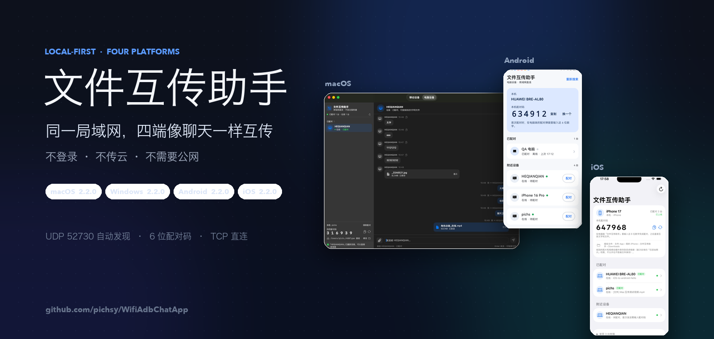
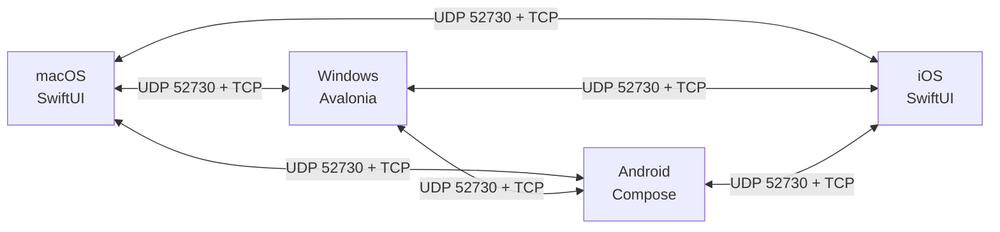

<div align="center">



<br />

<a href="https://github.com/pichsy/WifiAdbChatApp/releases/tag/v2.2.0">
  
</a>


<h3>不登录 · 不传云 · 同一 Wi-Fi 直接互传</h3>

<p>
  macOS / Windows / Android / iOS 四端原生 App。<br />
  自动发现、6 位配对码、像微信一样收发文字和文件；数据不经过服务器。
</p>

</div>

> **一句话**：把「就在旁边，却要经过微信 / 网盘 / U 盘」的文字和文件，变成同一局域网内的直连传输。
>
> **适合**：办公室电脑互传、Mac ↔ 手机、Windows ↔ 手机、临时给同事发安装包、在没有外网的环境传文件。
>
> **不适合**：公网穿透、跨网络远距离传输、需要端到端加密的敏感数据。

---

## 🚀 为什么是它

| 零服务器 | 四端原生 | 文件可控 |
| --- | --- | --- |
| UDP 52730 自动发现，TCP 直连；不登录、不上传云端、不需要公网。 | macOS（SwiftUI）、Windows（Avalonia）、Android（Compose）、iOS（SwiftUI），同一套协议和缓存。 | 进度百分比、取消、重名编号、半截文件清理；接收文件放在用户能直接找到的目录。 |

| 断线自愈 | 每设备独立会话 | 手机也能直接收 |
| --- | --- | --- |
| 2 秒心跳 + 已知设备单播 + 自动重连；网络切换 / 睡眠唤醒后恢复。 | 按设备 ID 存 `chats/<设备ID>.json`，离线 / 重启后历史还在；清空只影响当前会话。 | Android 存公共「下载/文件互传助手」，iOS 存「文件」App 的 Downloads，图片 / 视频还可进相册。 |

---

## 🖥️ 平台与状态

| 平台 | 版本 | 状态 | 安装包 |
| --- | --- | --- | --- |
| macOS 13+ | **2.2.0** | 电脑互传 + USB ADB 手机输入 / 文件 / 截屏；文件浏览为新增源码功能，待重新打包 | [dmg](release/文件互传助手-2.2.0.dmg) |
| Windows 10 1809+ / 11 x64 | **2.2.0** | 电脑互传 + 移动设备截屏；居中胶囊页签 + 圆角窗口 | [安装包](release/文件互传助手-2.2.0-安装包.exe) |
| Android 8.0+（API 28） | **2.2.0** | 只做电脑互传；公共下载落盘 / 图片视频预览 | [APK](release/文件互传助手-Android-2.2.0.apk) |
| iOS 17+ | **2.2.0** | 只做电脑互传；Files 可见 Downloads / 相册 / AVKit | [IPA](release/文件互传助手-iOS-2.2.0.ipa) |

> Android / iOS 端**不做** ADB、USB 调试、手机输入、移动设备页——只和电脑互传。
> iOS IPA 未签名；Android APK 已用项目 release key 签名。详见[下载说明](#-下载)。

---

## 📸 界面预览

| macOS · 电脑设备 | Windows · 电脑设备 |
| --- | --- |
|  |  |

| Android · 聊天缩略图 | iOS · 聊天缩略图 |
| --- | --- |
|  |  |

Windows 端会保留离线好友并显示「连接中断，正在重连…」：[离线好友截图](docs/screenshots/win-pc2.jpg)。
更多手机截图见 [Android README](mobile/android/README.md)、[iOS README](mobile/ios/README.md)。

---

## ✨ 核心能力

| 能力 | 说明 |
| --- | --- |
| **发现 / 配对** | UDP 52730 广播 + 已知设备单播；6 位配对码，配对后持久化设备 ID。 |
| **文字聊天** | 左收右发、时间、复制、自动滚底；中文 / emoji 正常。 |
| **文件传输** | 多文件选择 / 拖拽 / 粘贴；256 KiB 分块流式传输，进度、取消、失败清理。 |
| **手机接收位置** | Android 公共 `Download/文件互传助手/`；iOS `Documents/Downloads/`（Files App 可见）+ 图片 / 视频存相册。 |
| **手机文件浏览** | macOS「移动设备」页打开独立窗口：常用目录、路径跳转、大小/时间/权限、隐藏文件、下载到 Mac、上传到手机（源码版，待重新打包）。 |
| **图片 / 视频** | 120×90 缩略图，点击全屏缩放 / 播放；Android 用 filepicker，iOS 用 AVKit。 |
| **多设备会话** | 每设备独立缓存、好友列表、离线保留、别名、手动 / 自动重连。 |
| **桌面增强** | macOS 关闭 = 最小化到 Dock；Windows 关闭 = 收进托盘；Windows 移动设备页支持 ADB 截屏。 |
| **错误处理** | 连接 6s / 读写 30s 超时；对端退出、Wi-Fi 断开、端口占用都有中文提示，不崩溃。 |

---

## 🧠 架构



| 协议要点 | 值 |
| --- | --- |
| 发现 | UDP `52730`，2 秒广播 / 心跳，8 秒无心跳离线 |
| 传输 | TCP 随机端口，4 字节大端长度 + UTF-8 JSON |
| 单帧上限 | 16 MiB |
| 文件块 | 256 KiB 原始字节流 |
| 配对 | 6 位数字码，配对 ID 持久化 |
| 超时 | 连接 6s，读写 30s |

完整帧格式、握手、字段和验收清单见 [协议与界面规格](docs/LAN-transfer-spec.md)。

---

## ⚡ 快速开始

| 平台 | 最短路径 |
| --- | --- |
| **macOS** | `cd macos && ./build.sh` → 打开 `文件互传助手.app` |
| **Windows** | 运行 `release\文件互传助手-2.2.0-安装包.exe`，或 `windows\build.ps1` |
| **Android** | `cd mobile/android && ./gradlew assembleDebug`，或直接安装 release APK |
| **iOS** | `cd mobile/ios && xcodegen generate`，再用 Xcode / `xcodebuild` 构建 |

使用前确认：

1. 两台设备连**同一个 Wi-Fi / 局域网**；
2. 电脑端允许「本地网络」（macOS）或防火墙「专用网络」（Windows）；
3. 首次发送时，在对方屏幕上读出 6 位配对码并输入；
4. 配对后直接在聊天里发文字 / 文件即可。

各平台构建、权限、模拟器 / 真机步骤：
[macOS](macos/README.md) · [Windows](windows/README.md) · [Android / iOS](mobile/README.md) · [协议测试](mobile/tests/README.md)

---

## 📦 下载

| 平台 | 文件 | 大小 | 说明 |
| --- | --- | --- | --- |
| macOS | [文件互传助手-2.2.0.dmg](release/文件互传助手-2.2.0.dmg) | 3.4 MB | 通用二进制（Apple 芯片 / Intel），未公证 |
| Windows | [文件互传助手-2.2.0-安装包.exe](release/文件互传助手-2.2.0-安装包.exe) | 28.1 MB | 自包含 .NET 8，安装向导 |
| Android | [文件互传助手-Android-2.2.0.apk](release/文件互传助手-Android-2.2.0.apk) | 42 MB | release key 签名，可直接侧载 |
| iOS | [文件互传助手-iOS-2.2.0.ipa](release/文件互传助手-iOS-2.2.0.ipa) | 2.2 MB | 未签名，需自己的 Team 重签 |

- 校验值：[`release/SHA256SUMS.txt`](release/SHA256SUMS.txt) · 安装细节：[`release/README.md`](release/README.md)
- GitHub Release：[v2.2.0](https://github.com/pichsy/WifiAdbChatApp/releases/tag/v2.2.0)（附件名因 GitHub 限制使用 ASCII）
- Android 如果装过旧 debug 签名版，需先 `adb uninstall dev.local.adbtype.mobile` 再安装新签名 APK。
- iOS 首次运行需允许「本地网络」；图片 / 视频首次保存到相册会询问「仅添加照片」。

---

## 📚 文档地图

| 想了解 | 文档 |
| --- | --- |
| 5 分钟了解项目 / 选平台 | [文档中心](docs/README.md) |
| 产品能力、架构、实测数据 | [产品与技术](docs/product-and-tech.md) |
| 帧格式、握手、字段、验收 | [协议与界面规格](docs/LAN-transfer-spec.md) |
| macOS 构建 / 打包 / 限制 | [macOS README](macos/README.md) |
| Windows 构建 / 安装 / 防火墙 | [Windows README](windows/README.md) |
| Android / iOS 构建 / 权限 / 存储 | [移动端 README](mobile/README.md) |
| 协议参考对端 / 回归测试 | [mobile/tests](mobile/tests/README.md) |
| 2.2.0 更新内容 | [发布说明](docs/release-notes-2.2.0.md) |

---

## 🔒 安全与边界

- 局域网直连是**明文 TCP**，没有加密 / 身份校验，仅适合可信家庭、办公室或热点网络。
- 公司 / 酒店 Wi-Fi 常有 AP 隔离；两端互相搜不到时，换手机热点再试。
- iOS 进入后台会被系统挂起，接收消息需保持前台；Android 无前台服务，长时间后台可能收不到。
- macOS 未签名 / 未公证；Windows 安装包未做代码签名；iOS IPA 未签名。首次打开可能被系统安全提示拦截，按各端 README 放行。
- 公网穿透、跨网络、端到端加密不在本项目范围内。

---

## 🗂️ 仓库结构

<details>
<summary>展开目录</summary>

```text
.
├─ macos/                 macOS 端（SwiftUI + AppKit）
├─ windows/               Windows 端（Avalonia + .NET 8）
├─ mobile/
│  ├─ android/            Android（Kotlin + Compose）
│  ├─ ios/                iOS（SwiftUI）
│  ├─ tests/              Python 协议参考对端 + 回归测试
│  └─ README.md
├─ release/               正式安装包 + SHA256SUMS
├─ docs/
│  ├─ README.md           文档中心
│  ├─ product-and-tech.md 产品 / 架构 / 实测
│  ├─ LAN-transfer-spec.md 协议 + 界面规格
│  └─ screenshots/        界面截图
├─ README.md
└─ .gitignore
```

</details>

> 改名说明：App 显示名统一为「文件互传助手」；内部 Bundle ID、可执行文件名和协议广播标识仍是 `ADBType` / `ADBTypeLink`，旧版本配对和聊天记录继续有效。

---

<div align="center">

**如果这个项目帮你省下了几次微信传文件，欢迎 Star ⭐**

[GitHub](https://github.com/pichsy/WifiAdbChatApp) · [Gitee](https://gitee.com/pichs/WifiAdbChatApp) · [Releases](https://github.com/pichsy/WifiAdbChatApp/releases)

<sub>最后更新：2026-11-05 · v2.2.0</sub>

</div>
