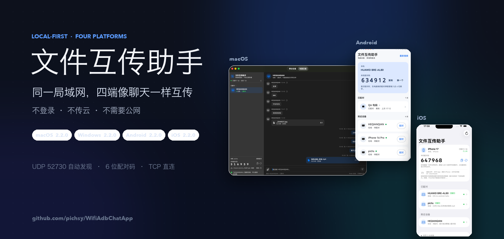
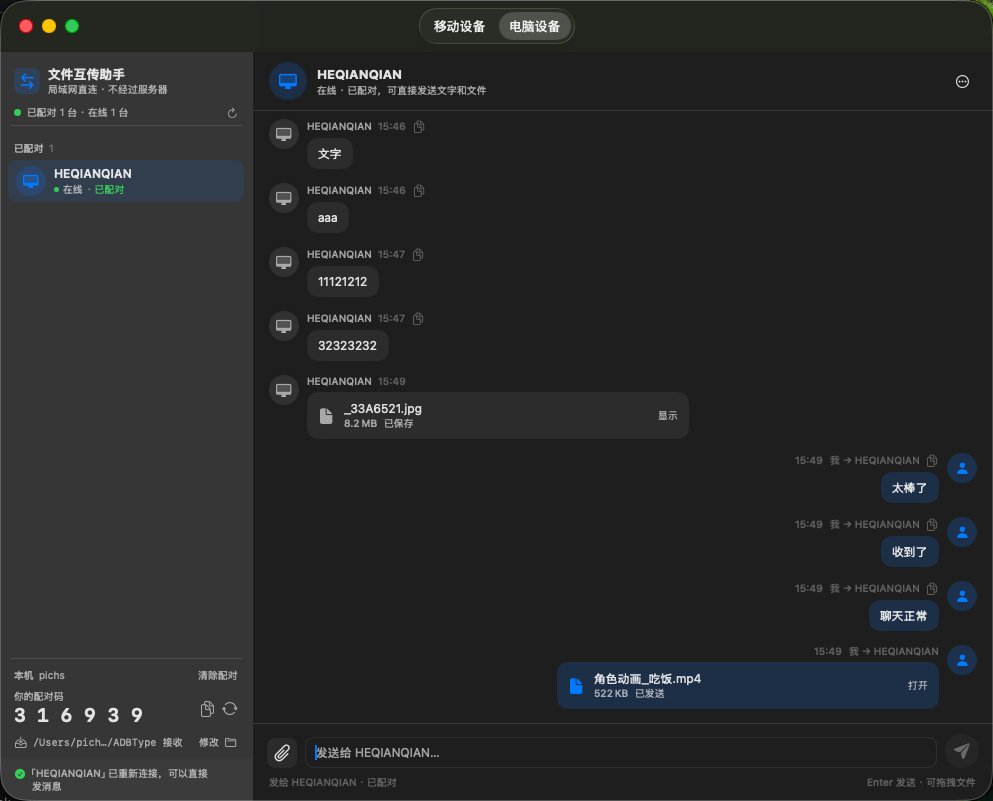
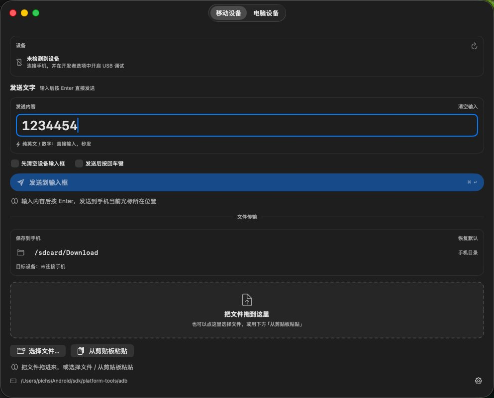
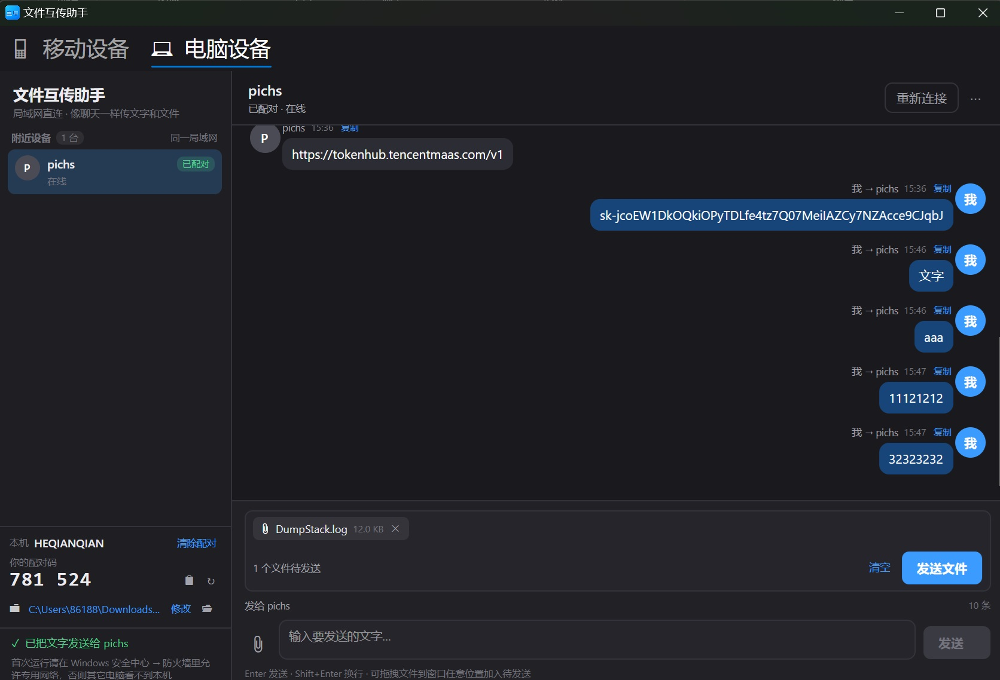
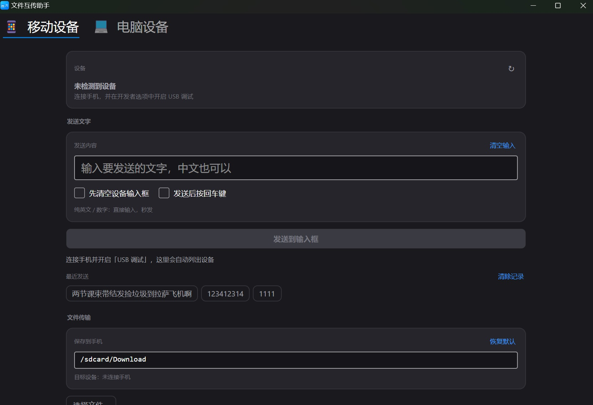
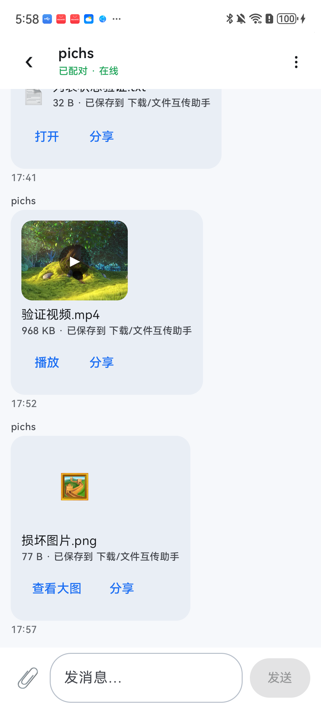
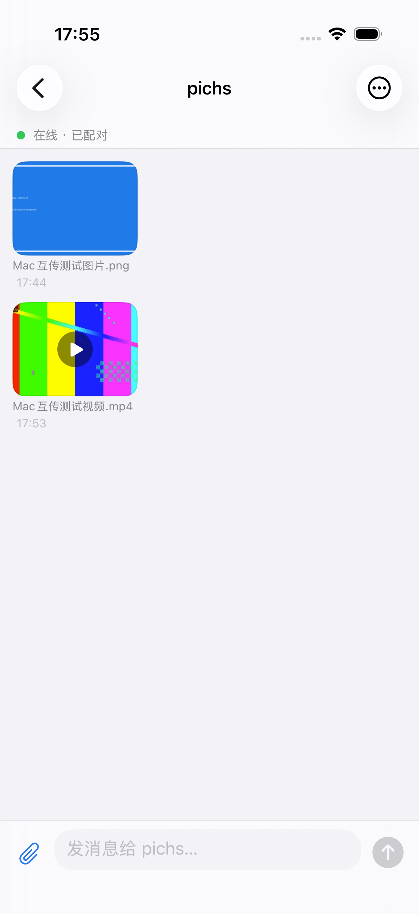

<h1>📚 文档中心</h1>

  文件互传助手 <b>v2.2.0</b> · macOS / Windows / Android / iOS 四端原生 
  从「怎么装」到「协议怎么实现」，按需进入。

---

## 🚀 5 分钟了解

| 步骤 | 看什么 |
| --- | --- |
| 1. 看看它长什么样 | [项目首页](../README.md) 的界面预览 |
| 2. 选平台、下载安装 | [平台速览](#-平台速览) · [release](../release/README.md) |
| 3. 第一次连接 | [快速开始](../README.md#-快速开始) · [配对与协议](LAN-transfer-spec.md#4-连接与握手) |
| 4. 深入技术 | [产品与架构](product-and-tech.md) · [协议规格](LAN-transfer-spec.md) |

> 核心体验：同一 Wi-Fi 自动发现 → 输入对方 6 位配对码 → 像聊天一样收发文字和文件。
> 不登录、不经过服务器，适合办公室、家庭和临时热点。

---

## 🧭 按角色找文档

| 我是 | 推荐阅读 |
| --- | --- |
| **第一次使用** | [项目首页](../README.md) → [下载安装](../release/README.md) → [常见问题](#-常见问题) |
| **macOS 用户 / 开发者** | [macOS README](../macos/README.md) · [协议规格](LAN-transfer-spec.md) |
| **Windows 用户 / 开发者** | [Windows README](../windows/README.md) · [Windows 测试清单](../windows/TESTING.md) |
| **Android / iOS 开发者** | [移动端 README](../mobile/README.md) · [Android](../mobile/android/README.md) / [iOS](../mobile/ios/README.md) |
| **协议 / 后端** | [协议与界面规格](LAN-transfer-spec.md) · [参考对端与测试](../mobile/tests/README.md) |
| **发布 / 维护** | [发布说明](release-notes-2.2.0.md) · [release 目录](../release/README.md) |

---

## 🖥️ 平台速览

| 平台 | 最低系统 | 版本 | 适合 |
| --- | --- | --- | --- |
| macOS | 13+ | 2.2.0 | 电脑互传 + USB ADB 手机输入 / 文件 / 截屏 |
| Windows | 10 1809+ / 11 x64 | 2.2.0 | 电脑互传 + 移动设备截屏；胶囊页签 / 圆角窗口 |
| Android | 8.0+ | 2.2.0 | 只做电脑互传；公共下载 / 图片视频预览 |
| iOS | 17+ | 2.2.0 | 只做电脑互传；Files Downloads / 相册 / AVKit |

安装包、校验值和签名说明统一在 [release/README.md](../release/README.md)。
Android APK 已用项目 release key 签名；iOS IPA 未签名，需要自己的 Team 重签。

---

## 🗺️ 文档地图

| 文档 | 内容 |
| --- | --- |
| [产品与技术](product-and-tech.md) | 产品定位、界面、能力全景、架构、实测数据、技术栈 |
| [协议与界面规格](LAN-transfer-spec.md) | UDP 发现、TCP 帧、握手、消息类型、文件传输、持久化、验收清单 |
| [macOS](../macos/README.md) | 构建、打包、手机输入 / 文件 / 截屏、调试 |
| [Windows](../windows/README.md) | Avalonia 构建、安装包、防火墙、托盘、界面说明 |
| [Android / iOS](../mobile/README.md) | 移动端构建、权限、存储位置、测试与已知限制 |
| [Android 细节](../mobile/android/README.md) | Kotlin / Compose、MediaStore、filepicker、签名 |
| [iOS 细节](../mobile/ios/README.md) | SwiftUI、Files / Photos、AVKit、XcodeGen |
| [协议参考对端](../mobile/tests/README.md) | Python 零依赖参考实现 + 回归测试 |
| [2.2.0 发布说明](release-notes-2.2.0.md) | 本轮功能、版本、校验值、升级提示 |

---

## 🖼️ 截图索引

| 页面 | 截图 |
| --- | --- |
| macOS 电脑设备 |  |
| macOS 移动设备 |  |
| Windows 电脑设备 |  |
| Windows 移动设备 |  |
| Android 聊天 |  |
| iOS 聊天 |  |

---

## ❓ 常见问题

| 问题 | 处理 |
| --- | --- |
| 搜不到对方 | 确认同一 Wi-Fi；关闭 AP 隔离 / 访客网络；Windows 放行防火墙专用网络；换手机热点再试 |
| 首次发送要配对码 | 看对方设备屏幕上的 6 位数字，输入后自动记住 |
| 手机收到的文件在哪 | Android：下载/文件互传助手；iOS：文件 App › 我的 iPhone › 文件互传助手 › Downloads |
| iOS 后台收不到 | iOS 会挂起后台 App，接收时保持前台 |
| 端口被占用 / adb 异常 | macOS / Windows 都提供「重启 adb」；关闭手机助手 / 模拟器后重试 |
| 安装包被系统拦截 | macOS 右键打开；Windows SmartScreen 选择仍要运行；iOS IPA 需重签 |

---

## 🏷️ 版本与更新

- 当前版本：**v2.2.0**（macOS / Windows / Android / iOS）
- 发布标签：[v2.2.0](https://github.com/pichsy/WifiAdbChatApp/releases/tag/v2.2.0)
- 更新记录：[2.2.0 发布说明](release-notes-2.2.0.md)
- 代码仓库：[GitHub](https://github.com/pichsy/WifiAdbChatApp) · [Gitee](https://gitee.com/pichs/WifiAdbChatApp)

文档最后更新：2026-11-05 · 与 v2.2.0 安装包同步

