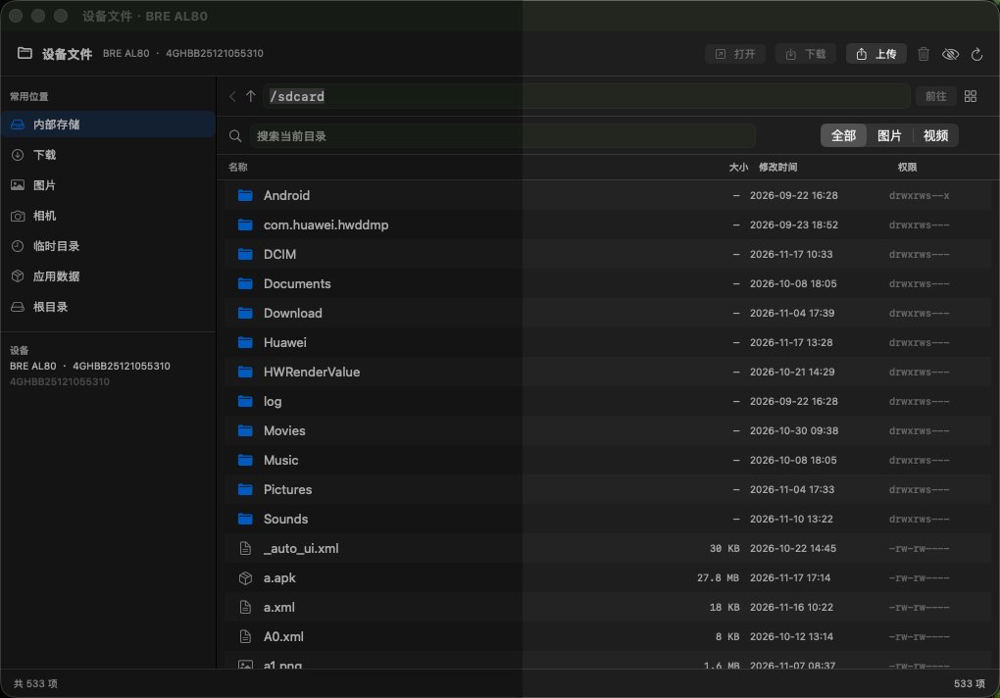
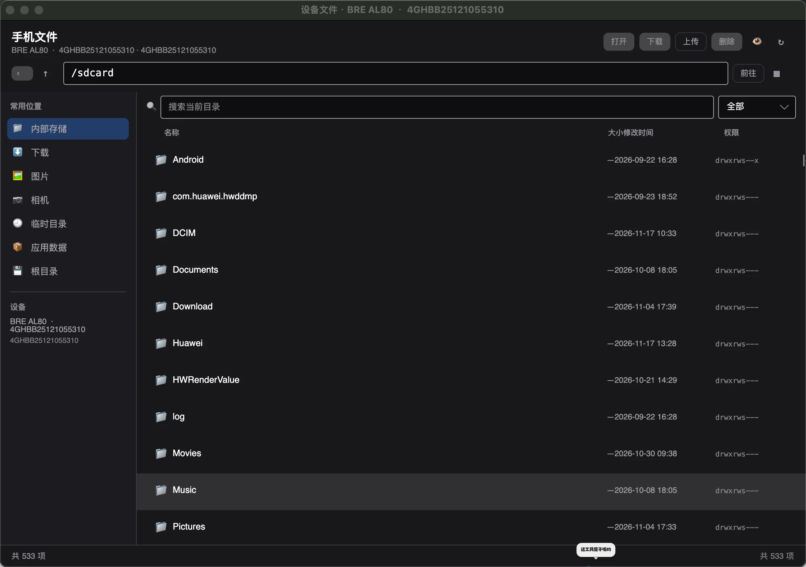

# ADB 手机管理：文件浏览、文件传输与手机截屏

> 适用版本：macOS **2.4.0** / Windows **2.4.0**<br>
> 适用设备：通过 ADB 连接的 Android 手机（iOS 不提供 ADB 功能）<br>
> 相关源码：macOS `macos/Sources/DeviceFileBrowser*.swift`、`FileTransferModel.swift`、`ScreenshotSheet.swift`；Windows `windows/src/ADBTypeLink.App/FileBrowserWindow.cs`、`Dialogs/ScreenshotWindow.cs`、`windows/src/ADBTypeLink.Core/DeviceFileService.cs`

这篇文档把「文件」窗口、移动设备页的文件推送、以及 ADB 截屏三块讲清楚：入口在哪里、
每一步实际执行什么 ADB 命令、哪些目录能改、哪些只能看，以及失败时怎么排查。

---

## 0. 先分清三种文件通道

| 通道 | 入口 | 方向 | 底层 | 适合 |
| --- | --- | --- | --- | --- |
| **ADB 文件浏览** | 移动设备 → 设备卡片「文件」 | 手机 ↔ 电脑 | `adb shell ls` / `adb pull` / `adb push` | 浏览手机目录、下载/上传、新建、删除、改名、批量管理 |
| **移动设备页待发送列表** | 拖拽 / 选择 / 粘贴 →「传到手机」 | 电脑 → 手机 | `adb push` | 快速把几个文件丢到手机默认目录 |
| **电脑设备聊天** | 电脑设备页聊天窗口 | 电脑 ↔ 手机 / 电脑 | 局域网 TCP 自定义协议 | 不插线互传；手机端和电脑端都要打开 App |

> ADB 文件窗口和移动设备页的推送都要求手机已开启 USB 调试并授权本机；
> 电脑设备聊天不需要 ADB，但需要两台设备在同一局域网并完成 6 位配对。

<p align="center">
  
  
</p>

---

## 1. 连接准备

### 1.1 手机端

1. 设置 → 关于手机 → 连续点「版本号」7 次，打开开发者选项；
2. 开发者选项 → 打开「USB 调试」；
3. 用数据线连接电脑，手机弹出「允许 USB 调试吗」时勾选「始终允许」并确定；
4. 如果只是充电线，换成能传数据的线；部分手机还需要在 USB 用途里选「文件传输」。

### 1.2 电脑端

macOS / Windows 都会按下列顺序查找 `adb`：

1. 用户手动选择的 adb 路径；
2. `ANDROID_HOME` / `ANDROID_SDK_ROOT` 下的 `platform-tools/adb`；
3. 常见 Android SDK 目录；
4. 系统 `PATH`（Windows 还会检查 `%LOCALAPPDATA%\Android\Sdk\platform-tools`）。

macOS 额外会通过登录 shell 查找 Homebrew / zsh 配置里的 adb；Windows 可在页面底部
「设置 adb…」手动指定。找不到 adb 时，文件窗口和截屏按钮会直接提示，不会静默失败。

### 1.3 用 adb 自检

```bash
adb devices -l
```

正常情况下会看到：

```text
List of devices attached
M7801MEVT5A013    device usb:... product:... model:...
```

| 状态 | 含义 | 处理 |
| --- | --- | --- |
| `device` | 已授权，可操作 | 正常使用 |
| `unauthorized` | 手机还没点允许 | 解锁手机，在弹窗点「允许」；不行就撤销 USB 调试授权后重插 |
| `offline` | adb 连接异常 | 重新插拔 / 执行 `adb reconnect` / 重启 adb |
| 没有设备 | 线、驱动或调试未开 | 换线、换 USB 口、检查驱动 |

连接多台手机时，App 会用设备序列号区分；文件窗口按设备复用，不会把 A 手机的目录操作发到 B 手机。

### 1.4 adb 5037 端口冲突

QtScrcpy、模拟器、手机助手等工具可能启动自己的 adb，版本不一致时会出现
`adb devices` 有设备、但 `adb shell` / `adb push` 卡死。处理方式：

- 使用 App 里的「重启 adb」/「重新检测 adb」；
- 或手动执行 `adb kill-server` 后再 `adb start-server`；
- 最好让所有工具使用同一个 `platform-tools/adb`。

---

## 2. 「文件」窗口：ADB 文件管理

### 2.1 打开方式

- macOS：移动设备页 → 选中设备 → 设备卡片右上角「文件」；
- Windows：移动设备页 → 设备卡片「文件」。

文件窗口是**独立窗口**，可以同时打开多台手机的窗口；关闭文件窗口只关闭它自己，
不会退出主程序，也不会影响另一台手机的文件窗口。主窗口的关闭行为保持不变
（macOS 最小化到 Dock，Windows 收进托盘）。

### 2.2 界面分区

| 区域 | 内容 |
| --- | --- |
| 顶部工具栏 | 打开、下载、上传、删除、显示/隐藏隐藏文件、刷新 |
| 路径栏 | 返回、上一级、路径输入框、「前往」、列表/网格切换 |
| 搜索过滤栏 | 当前目录模糊搜索、清空按钮、全部/图片/视频过滤 |
| 左侧栏 | 内部存储、下载、图片、相机、临时目录、应用数据、根目录、设备信息 |
| 主区域 | 列表或网格文件视图；底部状态栏显示项数和选中数 |

列表列包含：名称、大小、修改时间、权限。文件夹排在文件前面，目录显示为文件夹图标；
隐藏文件默认不显示，点「眼睛」按钮后显示以 `.` 开头的条目。

### 2.3 目录导航与路径

- 左侧快捷入口直接跳到常用目录；
- 双击文件夹进入；双击文件会下载到临时目录并用系统默认 App 打开；
- 路径栏输入路径后点「前往」；
- 输入的是**文件路径**时：进入该文件所在目录并选中该文件，不会直接打开文件；
- 只接受手机路径（以 `/` 开头），输入 Mac / Windows 本机路径会被拦截；
- 路径会做规范化，`..` 不能跳出预期目录；
- 根目录下会隐藏 `bin`、`d`、`etc`、`cache`、`init` 等系统软链和不可访问占位项；
- 软链接 / 文件夹快捷方式在打开前会先解析目标：目标是目录就跳转，目标是文件才下载；
- 每 4 秒静默刷新设备列表；文件窗口本身在操作后主动刷新，顶部刷新按钮可手动刷新当前目录。

### 2.4 搜索与类型过滤

路径框下方是独立的一行：

| 控件 | 行为 |
| --- | --- |
| 搜索框 | 只匹配**当前目录已经加载出来的名称**；不递归、不重新扫描手机 |
| 模糊规则 | 先做不区分大小写的包含匹配；不命中时按字符顺序做子序列匹配 |
| 全部 | 显示当前目录所有条目（仍受隐藏文件设置影响） |
| 图片 | 只显示图片文件（jpg/jpeg/png/gif/webp/bmp/tif/tiff/heic/heif/avif/ico） |
| 视频 | 只显示视频文件（mp4/mov/m4v/3gp/3g2/mkv/avi/webm/flv/wmv/ts/m2ts） |

搜索和类型过滤是**叠加**关系：例如搜索 `screen` 并选择「图片」，只显示名称匹配的图片。
过滤后自动清掉已经不可见的选中项；没有匹配时显示「没有匹配的文件」。
“图片 / 视频”过滤只显示文件，不显示文件夹。

### 2.5 列表 / 网格与缩略图

- 「前往」后面的按钮切换列表 / 网格，按钮图标同步变化；
- 网格卡片等宽等高，文件名单行、中间省略；
- 图片、GIF、视频异步加载缩略图，加载失败或非媒体文件显示图标；
- macOS 图片/GIF 用 ImageIO，视频用 AVFoundation；Windows 图片用 Avalonia 解码，
  视频/GIF 用 Windows Shell 缩略图；
- 缩略图只是浏览辅助，不会修改手机文件，也不会把原图完整下载到手机相册。

### 2.6 选中与右键目标

macOS：

- 单击一行：取消其它选择，只选当前行；
- `Command` + 单击：切换该行选中状态；
- `Shift` + 单击：从上次选中行连选；
- 在已选中的行上右键：保留多选，菜单中的「新建 / 上传 / 打开」置灰；
- 在未选中的行上右键：先清空其它选择，只选中该行，再弹正常菜单；
- 右键空白处：不改变当前选择，按当前目录显示菜单。

Windows：

- 单击：单选；
- `Ctrl` + 单击：多选 / 取消；
- `Shift` + 单击：连选；
- 右键选中行 / 未选中行的规则与 macOS 相同。

所有选中项使用蓝色填充背景；顶部「下载」「删除」按当前选中项工作，
「打开」只在单选时可用。状态栏显示「已选 N 项 · 共 M 项」。

### 2.7 右键菜单和文件操作

| 菜单项 | 作用 | 目标目录 / 限制 |
| --- | --- | --- |
| 新建 → 文件 | `: > path` 创建空文件 | 右键文件夹时建在该文件夹内；右键文件/空白建在当前目录 |
| 新建 → 文件夹 | `mkdir -p path` | 同上 |
| 上传到当前目录… | 选择文件上传 | 右键文件/空白时上传到当前目录 |
| 上传到此文件夹… | 选择文件夹上传 | 右键目录时直接传到该目录 |
| 打开文件夹 / 打开文件 | 进入目录 / 下载后用默认 App 打开 | 单选项 |
| 下载到电脑… | 单个文件用保存面板；多选/目录用目标文件夹 | 多选按原名保存，目录递归下载 |
| 复制路径 | 复制选中项路径 | 多选时每行一个路径，换行拼接 |
| 刷新 | 重新读取当前目录 | 任何右键场景都提供 |
| 删除… | 删除选中项 | 始终弹确认；目录会连同内容删除 |

补充规则：

- 新建成功后自动刷新并选中新项目；
- 删除按钮是 `rm -rf` 级操作，取消确认框不会删除任何内容；
- 多选下载会为每一项保留原文件名，目录下载会递归拉取；
- 单个文件下载会弹出保存面板，可在电脑上改名；
- 上传支持文件和文件夹；上传到同名路径时按 adb 的覆盖行为处理，不会自动加序号；
- 「应用数据」目录是只读的：新建、上传、删除按钮都不可用。

### 2.8 /data/data 应用数据

普通 adb shell 通常无法直接读取 `/data/data`：

1. App 先执行 `adb shell pm list packages`，把包名合成为可浏览的包目录；
2. 进入包目录后，如果是 **debuggable** 应用，使用
   `run-as <包名> ls -la ...` 以应用自身权限读取；
3. 可查看 `files`、`shared_prefs`、`cache` 等应用沙盒目录；
4. 非 debuggable 应用只显示包名，进入时提示权限不足；
5. 这个区域始终只读：不能新建、上传、删除或修改，避免误删应用数据。

> 这不是 root。没有 debuggable 标记的应用，普通 ADB 无法绕过系统权限读取其私有数据。

### 2.9 文件下载细节

- 单个文件：点「下载到电脑…」或双击，弹出保存位置；双击打开时保存到临时目录；
- 多个文件 / 文件夹：选择目标文件夹，按手机上的原名称保存，不重命名；
- 下载目录在手机上会递归拉取；下载期间显示整体进度；
- 下载失败会清理未完成的本地文件，避免留下半截文件；
- 保存到本地同名文件时，单个下载可以在保存面板改名；多选下载按原名覆盖/写入目标目录。

### 2.10 文件上传细节

- 「上传」选文件，可多选；
- 右键目录选「上传到此文件夹…」会把内容直接放到该目录；
- 文件窗口的上传支持整个文件夹，底层由 `adb push` 递归推送；
- 移动设备页的快速推送列表只接受**单个文件**，不支持整个文件夹；需要传文件夹请用文件窗口；
- 上传时显示百分比，完成后刷新目录；上传到只读应用数据目录会被直接拒绝。

---

## 3. 移动设备页：快速文件推送

这是「不打开文件窗口、快速把文件丢到手机」的通道。

### 3.1 添加文件

macOS：

- 拖拽文件到待发送区域；
- 「选择文件…」打开文件选择器；
- 「从剪贴板粘贴」：文件、图片、纯文本都可以；
  - 剪贴板图片会保存成 `剪贴板图片-yyyyMMdd-HHmmss.png`；
  - 纯文本会保存成 `剪贴板文本-yyyyMMdd-HHmmss.txt`。

Windows：

- 「选择文件…」添加任意数量文件；
- 待发送列表显示文件名、大小、状态、进度，可单个移除或清空。

> 该列表只接受文件，不接受目录；需要传目录时请使用「文件」窗口的上传。

### 3.2 目标目录

- 默认 `/sdcard/Download`；
- 可在「保存到手机」输入框修改，设置会持久化；
- 目标目录为空时会回退到默认目录；
- 只接受手机路径，不能填电脑本地路径。

### 3.3 传输行为

1. 点击「传到手机」后逐个文件执行 `adb push -p`；
2. 每个文件有独立进度，列表汇总整体进度；
3. 文件名保持不变；同名文件按 adb 行为覆盖，不会自动重命名；
4. 某个文件失败不会回滚已经成功的文件；失败项保留错误信息，可重试/重新添加；
5. macOS 会先 `mkdir -p` 目标目录；Windows 由 adb push 写入指定目录；
6. 传输期间可以继续使用其它页面，但不要拔线或关闭 adb server。

> 这是电脑 → 手机的单向快速通道。手机 → 电脑请用文件窗口的下载，或电脑设备聊天里的文件消息。

---

## 4. ADB 截屏

### 4.1 抓取

截屏入口在移动设备页的设备卡片：

- macOS：设备卡片右上角「截屏」；
- Windows：设备卡片「截屏」。

底层命令：

```bash
adb -s <serial> exec-out screencap -p
```

必须使用 `exec-out` 而不是 `shell`：部分 adb/设备组合会在 `shell` 模式把换行转成 CRLF，
导致 PNG 数据损坏。App 收到的是原始 PNG 字节。

### 4.2 预览窗口

截屏在独立窗口中显示，不占用主窗口：

- 刷新截屏：重新抓取当前屏幕；
- 保存截屏：保存为 PNG；
- 保存位置…：选择保存目录（默认系统「下载」）；
- 1:1：恢复适应窗口大小；
- macOS：触控板捏合缩放、放大后拖拽平移、双击在适应窗口/2.5× 之间切换，按钮上方显示百分比；
- Windows：滚轮缩放、放大后拖拽平移、1:1 恢复，显示缩放百分比；
- Windows 左下角「保存到：…」后的文件夹按钮：打开最近一次保存的目录并选中文件。

### 4.3 保存规则

- 文件名：`截屏-yyyyMMdd-HHmmss.png`；
- 同一秒重复保存时自动追加 `(2)`、`(3)`；
- 默认保存到系统「下载」目录；保存目录会记住；
- 保存成功后显示 toast / 状态提示；macOS 可在 Finder 中定位；
- 截屏不经过云服务器，也不调用 macOS 屏幕录制权限，完全通过手机端的 `screencap` 完成。

### 4.4 常见错误

| 现象 | 原因 / 处理 |
| --- | --- |
| 未检测到设备 | 数据线、USB 调试、驱动或授权问题，先跑 `adb devices -l` |
| unauthorized | 在手机上点允许 USB 调试 |
| 截屏失败 / 黑屏 | 部分系统限制或锁屏状态；解锁手机后刷新重试 |
| 保存失败 | 目标目录没有写权限或磁盘已满，换一个「下载」目录 |
| adb 命令卡死 | 5037 端口被别的 adb 占用，用「重启 adb」 |

---

## 5. ADB 命令对照表

| 场景 | 命令 | 说明 |
| --- | --- | --- |
| 列出设备 | `adb devices -l` | 文件/截屏前自检 |
| 列出目录 | `adb -s <serial> shell ls -la <path>` | 解析名称、大小、时间、权限、软链 |
| 列出应用包 | `adb -s <serial> shell pm list packages` | 合成 `/data/data` 包目录 |
| 读取应用数据 | `adb -s <serial> shell run-as <pkg> ls -la <subpath>` | 仅 debuggable |
| 下载 | `adb -s <serial> pull -p <remote> <local>` | 文件窗口下载；目录递归 |
| 上传 | `adb -s <serial> push -p <local> <remote>` | 快速推送、文件窗口上传 |
| 新建目录 | `adb -s <serial> shell mkdir -p <path>` | 新建文件夹 |
| 新建空文件 | `adb -s <serial> shell ': > <path>'` | 新建文件 |
| 删除 | `adb -s <serial> shell rm -rf <path>` | 仅文件窗口，确认后执行 |
| 截屏 | `adb -s <serial> exec-out screencap -p` | 得到 PNG 字节 |
| 输入文字 | `adb -s <serial> shell input text ...` | 纯 ASCII 文本输入 |
| 写剪贴板 | `adb -s <serial> shell app_process ...` | 中文/emoji 文本走手机剪贴板 |

删除、覆盖类命令都具有破坏性；App 在 UI 上要求确认（删除）或使用系统保存面板（单文件下载），
不会提供批量静默删除入口。

---

## 6. macOS / Windows 差异

| 项目 | macOS | Windows |
| --- | --- | --- |
| 文件窗口入口 | 设备卡片「文件」 | 设备卡片「文件」 |
| 多选修饰键 | `Command` / `Shift` | `Ctrl` / `Shift` |
| 删除快捷键 | `⌘⌫` | 工具栏/右键菜单删除 |
| 文件打开 | 下载临时目录后交给默认 App | 同左，交给系统默认程序 |
| 缩略图 | ImageIO / AVFoundation | Avalonia + Windows Shell |
| 截屏缩放 | 触控板捏合 / 双击 / 拖拽 | 滚轮 / 拖拽 / 1:1 |
| 主窗口关闭 | 最小化到 Dock | 收进托盘 |
| 快速推送粘贴 | 支持文件/图片/文本 | 以文件选择器为主 |

两边协议、目录规则、只读边界和 ADB 命令保持一致。

---

## 7. 安全边界

- ADB 文件窗口只能操作**手机路径**；不能读写电脑文件系统的任意路径；
- 不申请 root，不绕过 Android 权限模型；
- `/data/data` 仅对 debuggable 应用开放 `run-as` 浏览，且始终只读；
- 删除、覆盖操作需要明确 UI 入口；删除必须确认；
- ADB 通道是 USB 本机连接；电脑设备聊天是局域网明文直连，不经过服务器，也不加密；
- 截屏不经过云服务，不调用系统屏幕录制权限，数据只在本机内存/下载目录中处理。

---

## 8. 排查清单

1. `adb devices -l` 是否显示 `device`？
2. 手机是否解锁、是否弹出了授权？
3. 当前 adb 是否与 QtScrcpy / 模拟器冲突？
4. 目标路径是否可写？`/sdcard/Download` 是否还有空间？
5. 是否在只读的「应用数据」目录里尝试新建/上传/删除？
6. 文件窗口是否还停留在旧目录？点一次「刷新」；
7. 搜索/过滤是否把目标隐藏了？清空搜索并选择「全部」；
8. 截屏失败时先解锁手机，再点「刷新截屏」。

如果仍然失败，请提供：设备型号、Android 版本、macOS/Windows 版本、`adb devices -l` 输出、
以及界面上出现的完整错误文案。

---

## 9. 代码索引

| 功能 | macOS | Windows |
| --- | --- | --- |
| ADB 进程与设备 | `macos/Sources/ADB.swift` | `windows/src/ADBTypeLink.Core/AdbService.cs` |
| 目录解析 / 文件模型 | `macos/Sources/DeviceFileBrowser.swift` | `windows/src/ADBTypeLink.Core/DeviceFileService.cs` |
| 文件窗口 UI | `macos/Sources/DeviceFileBrowserView.swift` | `windows/src/ADBTypeLink.App/FileBrowserWindow.cs` |
| 快速推送 | `macos/Sources/FileTransferModel.swift` | `windows/src/ADBTypeLink.App/ViewModels/MobileDeviceViewModel.cs` |
| 截屏 | `macos/Sources/ScreenshotSheet.swift` | `windows/src/ADBTypeLink.App/Dialogs/ScreenshotWindow.cs` |
| 缩略图 | `macos/Sources/DeviceFileThumbnail.swift` | `windows/src/ADBTypeLink.App/Helpers/ThumbnailLoader.cs` |
