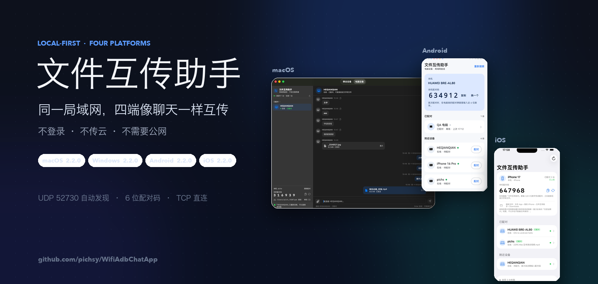
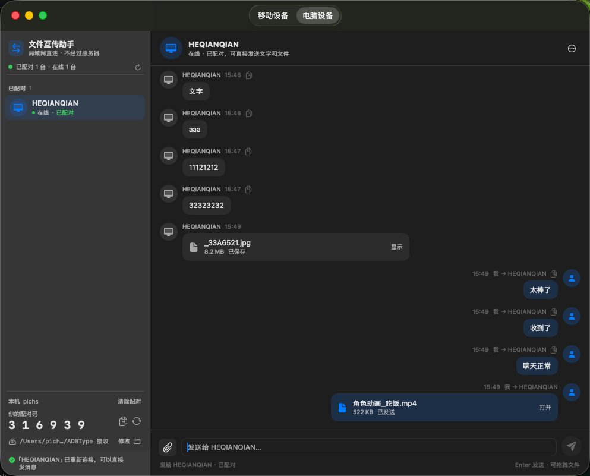
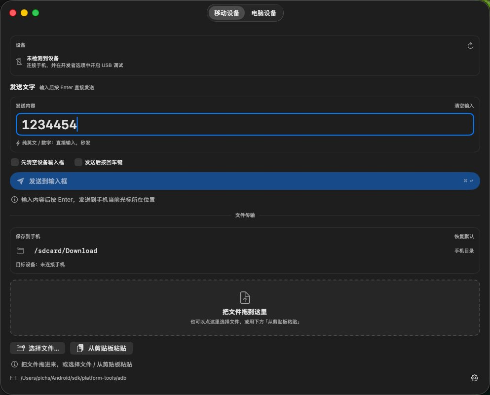
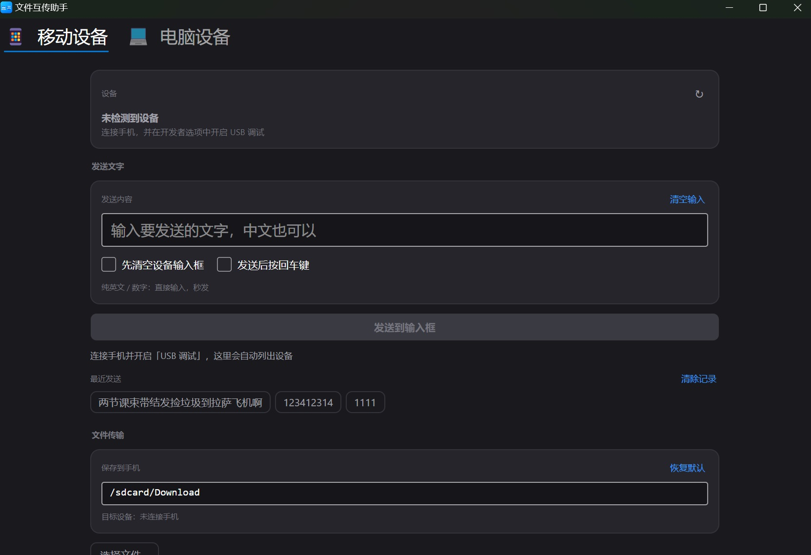
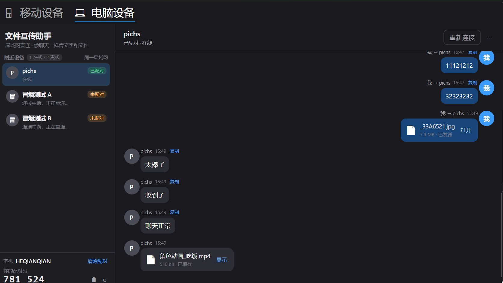
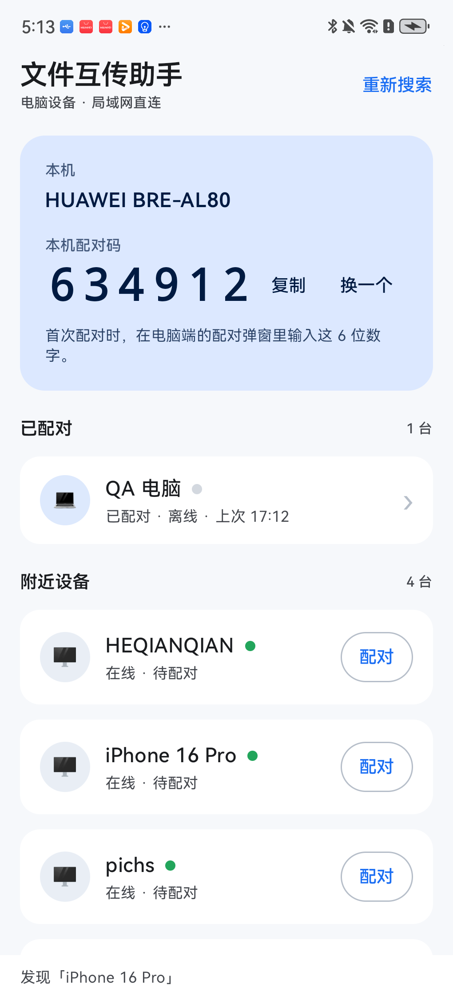
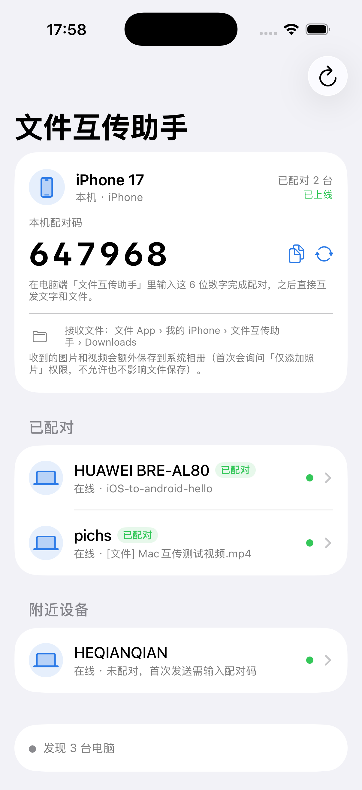
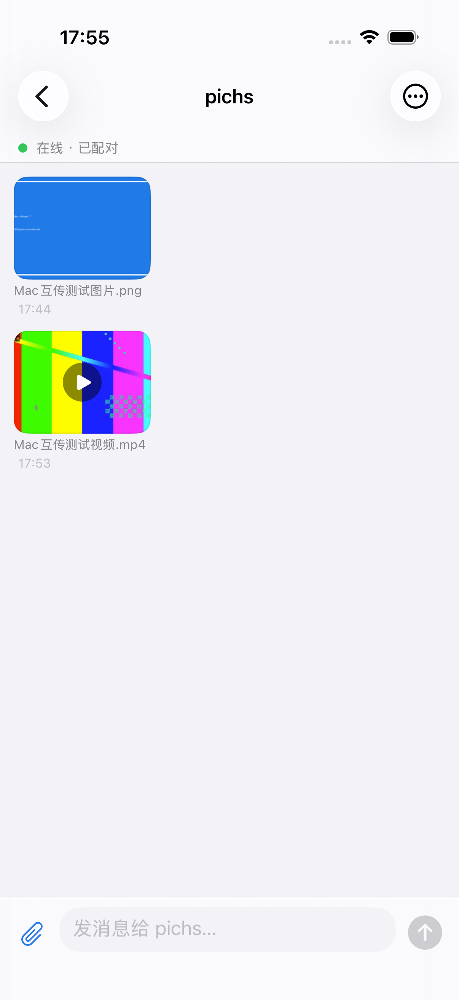
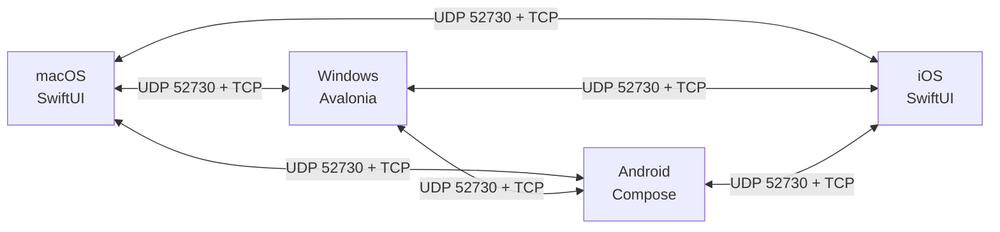

<div align="center">



</div>

# 文件互传助手 · 产品能力与核心技术

> 不登录、不传云、不装驱动。同一个 Wi-Fi 下，电脑 / 手机自动发现、配对，像聊天一样互传文字和文件；
> 插上 USB，macOS / Windows 还能把文字、文件和手机当前屏幕直接送进手机。
>
> **当前版本**：macOS 2.3.0 · Windows 2.3.0 · Android 2.2.0 · iOS 2.2.0
> **更新**：2026-11-11 · **适用**：产品 / 测试 / 新同学

## 目录

| 章节 | 内容 |
| --- | --- |
| [1. 产品定位](#1-产品定位) | 解决什么问题、不做什么 |
| [2. 界面一览](#2-界面一览) | macOS / Windows / Android / iOS 截图 |
| [3. 功能全景](#3-功能全景) | 能力清单 |
| [4. 核心技术](#4-核心技术) | 架构、发现、传输、会话、平台实现 |
| [5. 实测数据](#5-实测数据) | 真机 / 文件 / 测试结果 |
| [6. 安全边界](#6-安全边界请务必阅读) | 明文、配对码、使用场景 |
| [7. 技术栈](#7-技术栈与目录) | 各端技术、关键代码 |
| [8. 下载](#8-下载与快速开始) | 安装包与构建入口 |

## 1. 产品定位

文件互传助手解决的是「就在身边，却传得很麻烦」的问题：

- 办公室的 Mac 和 Windows 要互传一段文字、一张图、一个安装包，不想经过微信 / 网盘 / U 盘；
- 手机就在数据线旁边，只想把 Mac 上刚复制的一段话、一个文件直接送过去；
- 大文件不想上传云端，也不想等下载；
- 不希望注册账号、扫码登录、购买会员或依赖外网。

它不做的事也说清楚：不替代网盘、不做公网穿透、不做聊天内容加密。它是一把
「同一局域网内、两台设备之间」的直连瑞士军刀。

## 2. 界面一览

### 2.1 macOS · 电脑设备



左边是「已配对 + 附近设备」，右边是当前设备的独立聊天窗口。截图里可以看到：

- 已配对设备显示「在线 · 已配对」，掉线也不会消失，而是变成「离线 · 正在重连」；
- 文字、8.2 MB 的 JPG、522 KB 的 MP4 在同一个会话里按时间排列；
- 文件直接点「显示 / 打开」，不存在的文件会显示删除线并标注「文件已不存在」；
- 每条消息右键都有对应的操作菜单，窗口关闭按钮被改成了「最小化到 Dock」。

### 2.2 macOS · 移动设备



手机插上 USB、开启「开发者选项 → USB 调试」后：

- 在 Mac 输入框里打字，按 Enter 直接写进手机当前光标位置，中文也可以；
- 支持先清空手机输入框、发送后按回车；
- 文件可以拖拽或从剪贴板粘贴，选择后推送到 `/sdcard/Download`，带进度；
- adb 路径自动查找，找不到时可手动选择。

### 2.3 Windows 端

Windows 端使用 .NET 8 + Avalonia，界面与 macOS 端保持同一套交互：




离线好友仍然保留在列表里，显示「连接中断，正在重连…」，连接状态与历史记录互不影响：



### 2.4 Android / iOS 端

Android（Kotlin + Compose）和 iOS（SwiftUI）原生 App 只做「电脑设备」：和同一 Wi-Fi 的
macOS / Windows 发现、配对、收发文字和文件，不做 ADB / 手机输入 / 移动设备页。

| Android 首页 | Android 聊天（缩略图） |
| --- | --- |
|  |  |

| iOS 首页 | iOS 聊天（缩略图） |
| --- | --- |
|  |  |

图片 / 视频消息显示 120×90 缩略图，点击可全屏预览 / 播放；接收文件保存在用户可直接访问的位置，
详见 [`mobile/README.md`](../mobile/README.md)。

## 3. 功能全景

| 能力 | 说明 |
| --- | --- |
| 零配置发现 | 同一个 Wi-Fi 自动出现，无需输入 IP、无需扫描二维码 |
| 6 位配对码 | 首次发送输入对方屏幕上的 6 位数字，之后自动记住 |
| 文字聊天 | 左收右发、时间、复制、自动滚到底部 |
| 文件传输 | 拖拽 / 选择 / 多文件，显示进度百分比，可随时取消 |
| 已配对好友 | 好友常驻左侧列表，离线也在；支持本地别名、取消配对 |
| 每设备独立会话 | 选中谁只显示和谁的聊天，离线 / 重启后仍可查看 |
| 断线自愈 | 心跳、单播重连、网络切换 / 睡眠唤醒自动恢复 |
| 消息右键菜单 | 文字「复制文字」；文件「查看 / 打开文件位置 / 打开接收目录」 |
| 文件缺失标记 | 本地文件被删除后，文件名显示删除线并标注「文件已不存在」 |
| 关闭不退出 | macOS 关闭按钮 = 最小化到 Dock；Windows 关闭 = 收进托盘 |
| 手机输入 / 文件 | 通过 USB ADB 把文字注入手机输入框、把文件推进手机目录（仅 macOS / Windows） |
| 手机 ↔ 电脑 | Android / iOS 原生 App 和 macOS / Windows 配对，双向收发文字、文件 |
| 手机接收文件 | Android 存公共 `Download/文件互传助手/`；iOS 存「文件」App 的 `Documents/Downloads/`，图片 / 视频另存系统相册 |
| 手机图片 / 视频 | 120×90 缩略图，点击全屏缩放 / AVKit 播放 |
| 四端互通 | macOS / Windows / Android / iOS 使用同一套协议和缓存格式，可混用 |

## 4. 核心技术

### 4.1 总体架构：没有服务器



各端各自运行「发现 + 传输」两个模块，不经过任何中转服务器；Android / iOS 直接和
macOS / Windows 通信，手机之间也能在同一局域网配对：

- 没有账号体系，也就不存在「登录态过期 / 服务器宕机」；
- 没有文件上传，文件字节只在两台设备之间流动；
- 没有云端缓存，聊天记录落在本机应用支持目录。

### 4.2 发现：UDP 广播 + 已知设备单播

- 固定 UDP 端口 **52730**，每 **2 秒**广播一次；
- 同时发往 `255.255.255.255:52730` 和 `127.0.0.1:52730`（方便同一台电脑开两个实例联调）；
- 报文是 UTF-8 JSON，包含稳定的设备 ID、设备名、TCP 监听端口：

```json
{"app":"ADBTypeLink","v":1,"id":"<稳定的设备唯一 ID>","name":"<设备名>","port":<TCP 监听端口>}
```

- macOS 端还会向已知设备（含已配对好友）的 `IP:52730` **单播**同样的心跳，不依赖广播；
- 8 秒收不到心跳先标记「离线」，附近设备 2 分钟后移除，已配对好友永久保留；
  离线好友不会被隐藏，只是状态不同，历史记录照常可查；
- 网络切换、电脑睡眠唤醒后自动重建发现和监听，不要求用户重启 App。

### 4.3 传输：自定义长度前缀帧 + 原始文件流

每条 TCP 连接由发送方主动建立，端口在发现报文里通告（系统随机分配）。

```text
┌──────────────────┬──────────────────────────────────┐
│ 4 字节大端长度    │ UTF-8 JSON 正文（长度字节数）     │
└──────────────────┴──────────────────────────────────┘
```

- 单帧 JSON 上限 **16 MiB**，超限视为协议错误并断开；
- 文件内容**不套 JSON**：先发 `file` 头，再直接写 `size` 个原始字节；
- 文件按 **256 KiB** 一块流式读写，不把整个文件读进内存；
- 一次发送动作（一段文字，或一批文件中的一个文件）新建一条 TCP 连接，
  完成后发 `bye` 关闭；
- TCP connect 超时 **6 秒**，已建立连接的读写超时 **30 秒**。

消息类型：

| 类型 | 作用 |
| --- | --- |
| `hello` | 发起连接，带设备信息与配对声明 |
| `hello_ok` | 对方接受连接 |
| `pair_required` | 未配对，要求输入 6 位配对码 |
| `error` | 配对码错误、协议错误等 |
| `text` | 文字消息 |
| `file` | 文件头（文件名、大小），随后是原始字节 |
| `ok` | 接收方确认落盘 |
| `bye` | 结束本次连接 |

### 4.4 身份、配对与好友

- 设备首次启动生成稳定 UUID，存在本地；设备改名不会改变身份；
- 首次给某台设备发送时，对方回 `pair_required`，输入对方屏幕上的 6 位配对码；
- 配对成功后把设备 ID 写入 `paired.json`，并记录到 `friends.json`
  （id / name / host / port / lastSeen / alias）；
- 再次扫到同一设备直接恢复在线和配对关系，不弹配对框；
- 支持给好友起**本地别名**，别名只存本机，显示优先于设备名；取消配对时清除别名；
- 配对码可以随时更换；整套流程没有账号、没有云端。

### 4.5 稳定性：心跳、重连、异常防护

局域网传输最怕的不是「慢」，而是「看起来连着、其实已经断了」。项目里做了这些：

- **心跳与离线保留**：2 秒广播 + 已知设备单播；掉线先标「离线 · 正在重连」，不立刻删；
- **自动重连**：连接失败自动重试，网络切换 / 唤醒后重建套接字；
- **手动重连**：侧栏刷新 = 重新建立发现与监听；设备行「重连」= 单播心跳 + TCP 探活；
- **发送队列独立**：文件发送在单独队列，不阻塞发现循环；长文件传输期间设备仍然在线；
- **非阻塞 accept**：监听套接字设为非阻塞，收到连接不会卡住整个网络线程；
- **SIGPIPE / SO_NOSIGPIPE**：对方中途断开不会把整个 App 杀掉；
- **App Nap 防护**：后台 / 窗口最小化时通过 `beginActivity` 防止心跳被降频；
- **关闭即最小化**：macOS 红色关闭按钮改为最小化到 Dock，Windows 关闭收进托盘，
  后台传输和在线状态不中断。

### 4.6 文件传输：进度、取消、落盘

- 发送前先发 `file` 头，接收方创建文件、按 256 KiB 循环读满；
- 发送中显示百分比；点 X 取消时 `shutdown` 当前 socket，立即停止阻塞读写；
- 失败 / 取消会删除未完成的接收文件，不留半截文件；
- 接收目录可修改，重名文件自动编号；
- 文件消息记录路径、大小；本地文件被删除后，UI 显示删除线 +「文件已不存在」，
  右键直接打开接收目录。

### 4.7 每个设备独立会话缓存

聊天记录不是一条大时间线，而是**按设备 ID 分文件**：

- macOS：`~/Library/Application Support/ADBType/chats/<设备ID>.json`
- Windows：`%APPDATA%\ADBTypeLink\chats\<设备ID>.json`
- 配对信息：`paired.json`；好友 / 别名：`friends.json`；
- 选中哪台设备，只加载哪台设备的会话，互不串台；设备离线也能查看；
- 每个会话最多保留 500 条，清空只影响当前会话；
- 旧版单文件 `chat.json` 会按设备名 / 唯一好友合并导入，按消息 id 去重，
  原文件归档到 `legacy-chat/`，升级不丢历史。

### 4.8 macOS 原生体验

- SwiftUI 构建界面，AppKit 负责窗口与系统集成，无第三方依赖；
- 通用二进制（arm64 + x86_64），macOS 13+；
- 原生气泡、复制、拖拽、右键菜单、删除线、文件图标；
- 红色关闭按钮 = 最小化到 Dock；点 Dock 图标还原；⌘Q 才真正退出；
- 本地网络权限、App Nap、睡眠唤醒、Wi-Fi 切换都按 macOS 的行为处理。

### 4.9 手机侧：ADB 深度集成

- 自动查找 adb：保存路径 → `ANDROID_HOME` / `ANDROID_SDK_ROOT` → 常见 SDK 目录
  → Homebrew → 登录 shell PATH；
- 连接手机后列出设备序列号，支持多设备选择；
- 纯 ASCII 文本用 `adb shell input text` 直接注入；
- 中文 / 混合文本先把内容写进手机剪贴板（内置 dex），再触发粘贴；
- 清空输入框 = 光标移到末尾 + 退格 40 次；
- 文件通过 `adb push` 推送到 `/sdcard/Download`，解析进度；
- macOS 端「移动设备」页提供独立的**文件浏览**窗口：常用目录、路径跳转、大小 / 时间 / 权限、
  隐藏文件、下载到 Mac、上传到手机、默认 App 打开；多台手机可各开一个窗口（源码版，待重新打包）；
- 根目录隐藏 `bin` / `d` / `etc` / `cache` / `init` 等系统软链和不可访问项；软链目录会解析目标后跳转；
  路径只允许手机路径，输入 Mac 系统路径会被拦截；
- 路径栏「前往」后提供列表 / 网格切换；网格模式图片、GIF、视频显示缩略图，
  其它文件显示图标与单行省略文件名；
- 路径栏输入精确文件路径时进入父目录并选中文件，不打开；右键「新建」可建文件/文件夹，
  右键文件夹建在其中、右键文件或空白建在当前目录；右键文件夹上传会传入该文件夹，
  右键文件或空白处上传到当前目录；
  右键菜单在任何文件/文件夹上都提供「刷新」，与顶部刷新按钮一致；
  多选「复制路径」时，把所有选中路径用换行符拼接后一次复制；
  支持单击单选、Shift 连选、Cmd 多选；多选可下载到目标目录（按原名、目录递归、不重命名）；
  在已选行上右键保留多选但新建/上传置灰，在未选行上右键切换为单选；
  右键「删除…」或 **⌘⌫** 批量删除，所有删除入口都强制弹窗确认，取消不会删除；
- **/data/data 应用数据**：普通 adb shell 被 SELinux 拒绝时，用 `pm list packages` 列出包名；
  debuggable 应用通过 `run-as` 查看 `files / shared_prefs / cache`，非 debuggable 只显示包名并提示无权进入；
  该目录只读，禁止删除 / 新建 / 上传；
- adb server 被 QtScrcpy 等工具占用 5037 端口时自动重试一次。

### 4.10 Windows 端：同协议、同缓存、原生安装包

- .NET 8 + Avalonia 11.3.22，不依赖 WinForms / WPF；
- 核心库与 macOS 使用同一套发现 / 帧 / 配对逻辑，协议位对位互通；
- 每设备独立会话、好友、别名、离线重连、消息右键菜单与 macOS 对齐；
- 关闭窗口收进托盘，左键恢复，右键菜单可退出；
- 「移动设备」页支持 adb 截屏：独立可缩放窗口、滚轮/拖拽缩放、1:1 恢复、保存到下载目录并 toast 提示；
- 顶部页签改为 macOS 风格居中胶囊，窗口使用 DWM 圆角（Windows 11）/区域圆角（Windows 10）；
- NSIS 安装向导：可选安装目录（默认 `D:\Program Files\文件互传助手`）、
  桌面快捷方式、卸载；自包含发布，目标机不需要安装 .NET；
- 在 macOS 上即可完成 Windows 端编译、冒烟测试和电脑端联调。

### 4.11 移动端：只做电脑互传

- Android：Kotlin + Jetpack Compose，minSdk 28；iOS：Swift + SwiftUI，iOS 17+；两端复用同一套
  UDP 发现 / TCP 帧 / 6 位配对 / 每设备会话缓存。
- 不做 ADB、USB 调试、手机输入；只和电脑端 / 另一台手机互传文字与文件。
- **接收文件放用户可访问位置**：Android 公共 `Download/文件互传助手/`（MediaStore content URI）；
  iOS `Documents/Downloads/`（「文件」App 可见）并把图片 / 视频额外存入系统相册。
- 图片 / 视频消息显示 120×90 固定缩略图：Android 用 Glide + MediaMetadataRetriever，点击用
  filepicker 的 `ImagePreviewDialog` / `VideoPreviewDialog`；iOS 用 ImageIO / AVAssetImageGenerator，
  全屏缩放与 AVKit 播放。
- 真机实测：HUAWEI BRE-AL80（Android 12）↔ 真实 Mac / iPhone 17 模拟器文字双向；
  Android ↔ Mac 文件双向、iOS ↔ Mac 图片 / 视频文件与落盘校验。
- 详细构建、存储位置、测试结果见 [`mobile/README.md`](../mobile/README.md)。

## 5. 实测数据

| 场景 | 结果 |
| --- | --- |
| macOS ↔ Windows 中文文字 | 双向正常，无乱码 |
| Mac → Windows 1.5 MB 文件 | 接收后字节校验一致 |
| Windows → Mac 900 KB 文件 | 接收后字节校验一致 |
| 界面内发送 400 KB 文件 | 接收端字节一致 |
| 发送到 25% 时取消 | 立即停止，无残留文件，下一次发送正常 |
| 截图中的 8.2 MB JPG / 522 KB MP4 | 正常收发、可打开 |
| Android 真机 ↔ 真实 Mac | 文字双向、文件双向；公共 Downloads 落盘 sha256 一致 |
| Android 真机 ↔ iPhone 17 模拟器 | 6 位配对、文字双向通过 |
| iOS ↔ 真实 Mac | 图片 / 视频发送成功，容器 sha256 一致，Photos 写入成功 |
| Windows 冒烟测试 | 37/37 + 9/9 通过，0 warning |
| Android / iOS 测试 | Android 78 个 JVM 测试；iOS 49 个测试 + UI 预览测试通过 |
| 安装包 | macOS dmg 校验通过；Windows 安装 / 卸载 / 快捷方式；Android release key 签名；iOS IPA 未签名 |

## 6. 安全边界（请务必阅读）

- 局域网直连是**明文 TCP**，没有内容加密；
- 6 位配对码用于防止误连 / 误发，不是加密密钥；
- 适合可信的家庭、办公室局域网，不要在公共 Wi-Fi 上传敏感文件；
- 公司 / 酒店 Wi-Fi 常有 AP 隔离，两端互相搜不到时换手机热点；
- 手机输入依赖 USB 调试和 adb，请只在自己的设备上开启 USB 调试。

## 7. 技术栈与目录

| 部分 | 技术 |
| --- | --- |
| macOS | Swift / SwiftUI / AppKit，无第三方依赖，通用二进制 |
| Windows | C# / .NET 8 / Avalonia 11.3.22，NSIS 安装包 |
| Android | Kotlin / Jetpack Compose / MediaStore / filepicker，minSdk 28 |
| iOS | Swift / SwiftUI / AVKit / Photos，iOS 17+ |
| 协议 | UDP 发现 + TCP 长度前缀 JSON 帧 + 原始文件流 |
| 持久化 | 本地 JSON（paired / friends / chats / 迁移归档） |
| 手机侧 | Android adb、内置剪贴板 dex |

关键代码：

- 协议与传输：[LAN-transfer-spec.md](LAN-transfer-spec.md)
- macOS 网络核心：[`macos/Sources/LANTransfer.swift`](../macos/Sources/LANTransfer.swift)
- macOS 界面：[`macos/Sources/LANTransferView.swift`](../macos/Sources/LANTransferView.swift)
- Windows 核心：[`windows/src/ADBTypeLink.Core/`](../windows/src/ADBTypeLink.Core/)
- Windows 安装脚本：[`windows/installer/setup.nsi`](../windows/installer/setup.nsi)

## 8. 下载与快速开始

- macOS：[`release/文件互传助手-2.3.0.dmg`](../release/文件互传助手-2.3.0.dmg)
  （macOS 13+，arm64 + x86_64；另有 [zip](../release/文件互传助手-2.3.0-macOS.zip)）
- Android：[`release/文件互传助手-Android-2.2.0.apk`](../release/文件互传助手-Android-2.2.0.apk)
  （Android 8.0+，release key 签名）
- iOS：[`release/文件互传助手-iOS-2.2.0.ipa`](../release/文件互传助手-iOS-2.2.0.ipa)
  （iOS 17+，未签名，需自行重签）
- Windows：[`release/文件互传助手-2.2.0-安装包.exe`](../release/文件互传助手-2.2.0-安装包.exe)
  （旧安装包；2.3.0 文件窗口用 `windows/build.ps1` 构建，安装包待重打）
- 校验值：[`release/SHA256SUMS.txt`](../release/SHA256SUMS.txt)

从源码构建：

```bash
cd macos && ./package.sh        # dmg + zip
```

```powershell
powershell -ExecutionPolicy Bypass -File windows\build-release.ps1
```

> 不登录、不传云、没有服务器：文件只在两台设备之间跑。

