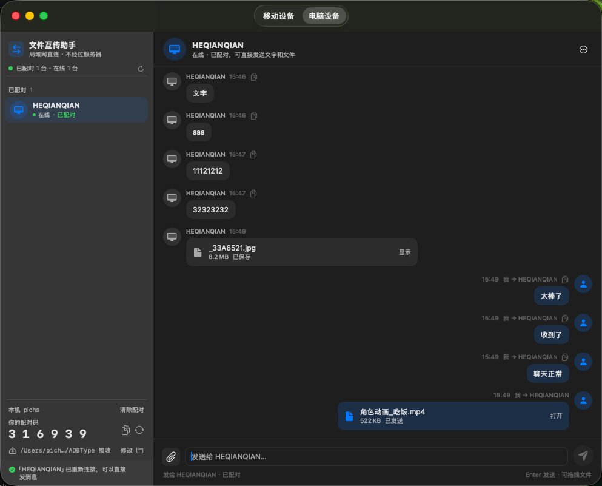
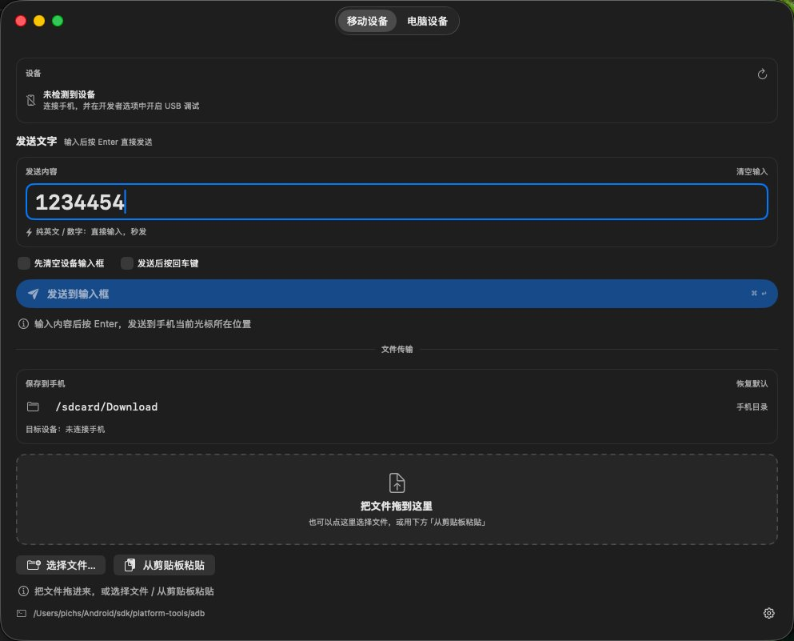

# 文件互传助手 · macOS 端

macOS 原生 SwiftUI 小工具（macOS 13+，无第三方依赖），包含两个页面：

1. **移动设备**：在 Mac 上输入内容直接打进手机当前输入框；也支持把文件传到手机。
2. **电脑设备**：和同一局域网里的 macOS / Windows 电脑像微信一样聊天，互发文字和文件。

Windows 端在 [`windows/`](../windows/)；移动端规划见 [`mobile/`](../mobile/)；
局域网协议见 [`docs/LAN-transfer-spec.md`](../docs/LAN-transfer-spec.md)。

界面预览：





完整产品能力与核心技术见 [`docs/product-and-tech.md`](../docs/product-and-tech.md)。

---

## 一、移动设备（手机输入 + 文件传输）

在 Mac 上输入内容，按 Enter，直接打进**手机当前获得焦点的输入框**。两条路径自动切换：

- **纯英文 / 数字**：按钮显示「发送到输入框」，`adb shell input text <内容>`，秒发。
- **含中文 / emoji**：按钮显示「发送到设备剪贴板」。`input text` 敲不了中文，于是把文字写进
  手机系统剪贴板，再由你在手机上长按输入框点「粘贴」。不碰手机上的任何界面，不会误操作。

写手机剪贴板用的是随 App 内置的一个 2 KB dex（`Resources/adbtype-clip.jar`），以 shell 身份
`app_process` 运行并调用系统 `IClipboard`。手机端不用装任何 App，也不用切输入法。

「移动设备」页也支持**文件传输**：

- 拖拽 / 选择 / 粘贴文件加入「待发送列表」，可单个移除或清空，点「传到手机」才发送；
- 目标目录可编辑，默认 `/sdcard/Download`，带进度显示。

设备卡片右上角还有**截屏**：

- 点「截屏」用 `adb exec-out screencap -p` 抓取手机当前屏幕，弹窗预览；
- 截屏窗口是独立可缩放窗口，拖四角/四边即可拉大或拉小，预览图会跟着窗口自适应；
- 弹窗内可「刷新截屏」「保存截屏」「保存位置…」；默认保存到系统「下载」目录，文件名带时间戳，重名自动编号；
- 预览支持触控板捏合缩放、放大后拖拽平移、双击切换缩放；「1:1」恢复适应窗口，按钮上方小字显示当前缩放百分比；
- 保存成功会弹一个「截屏已保存」的 toast，约 2 秒自动消失；
- 手机锁屏 / 未授权 USB 调试时给出错误提示，不影响其他功能。

### 使用手机功能

- 顶部选择设备（多台手机时）；插拔会自动刷新（窗口在前台时每 4 秒静默刷新一次）。
- 输入后 `Enter` 或 `⌘↩` 发送。
- **先清空设备输入框**：把光标移到末尾后连发 40 次退格，再输入新内容（仅英文/数字模式）。
- **发送后按回车键**：输入完再点一次 Enter，适合搜索框、聊天输入框（仅英文/数字模式）。
- 输入中文时按钮会变成「发送到设备剪贴板」，复制成功后状态栏会提示你去手机上长按粘贴。
- 发送成功后输入内容保持全选，直接键入下一个值即可覆盖。
- 最近 12 条发送记录，点击回填。

## 二、电脑设备（局域网互传，聊天式）

「电脑设备」页是一个完整的聊天窗口：

- **左边是「已配对」好友列表 + 「附近设备」**：配对过的设备会记进好友列表（friends.json），
  下次启动仍在，扫到同一台设备自动恢复在线，不需要重新配对；离线的好友也保留在列表里，
  选中后照样可以尝试发送，并会自动重连；支持给好友起**本地别名**（右键 / ⋯ 菜单），
  列表、聊天头部和历史消息都优先显示别名，取消配对会清掉该设备别名，
  ⋯ 菜单还可「清除全部别名缓存」；列表下方仍显示本机配对码、接收目录和状态；
- **关闭按钮 = 最小化**：点窗口红色关闭按钮只是最小化到 Dock，App 进程和后台互传继续运行；
  点 Dock 图标或重新打开 App 会还原窗口；要真正退出请用 ⌘Q 或 Dock 菜单「退出」；
- **每个设备独立会话**：聊天记录按设备 ID 缓存为 `chats/<设备ID>.json`，选中谁就只显示和谁的
  聊天内容；设备离线 / 重启后历史仍在；「清空当前会话」只影响当前设备，其他设备不受影响；
  老版本的 `chat.json` 会自动迁移并保留为 `chat.json.migrated`；
- **掉线自动重连**：心跳丢失先把设备标成「离线 · 正在重连」而不是直接消失；本地还会向已知设备
  单播心跳，Wi-Fi 切换 / 电脑睡眠唤醒后自动重建发现和监听；发送失败会先自动重试 3 次；
- **手动重连**：侧栏「发现 N 台设备」右侧的刷新按钮 = 重新建立发现并广播；聊天头部 / 好友行
  的「重连」按钮 = 针对当前设备做单播心跳 + TCP 探活；
- **右边是聊天记录**，收到的、发出去的文字和文件都按聊天气泡排列（左收右发、时间、复制、
  打开 / 在文件管理器中显示），新消息自动滚到底部；文件已不在本地时文件名显示删除线并标注
  「文件已不存在」；每条消息右键菜单：文字可「复制文字」，文件可「查看」/「打开文件位置」，
  文件不在时改为「打开接收目录」；
- **底部固定输入框**：附件按钮选择文件、待发送文件 chips、发送按钮；Enter 发送，文件也可直接
  拖进窗口，加入待发送列表后再点「发送文件」；发送中显示进度百分比，并带 **X 取消按钮**，
  取消后可以立即重新发送；
- 首次给某台设备发送需要输入**对方屏幕上的 6 位配对码**，输对一次后自动记住；配对码可随时
  换新、清除；
- 聊天记录、配对关系和好友列表持久化在 `~/Library/Application Support/ADBType/`
  （chats/<设备ID>.json / paired.json / friends.json），重启不丢；清空记录不会删除已收到的文件；
- 接收目录默认 `~/Downloads/ADBType 接收`，可在左侧修改，遇到重名文件会自动编号。

文字和文件在两台设备之间**直连传输，不经过任何服务器**，也没有账号和云端。

---

## 构建与运行

```bash
cd macos
./build.sh          # 需要 Xcode 命令行工具（swiftc），默认编 arm64 + x86_64 通用包
open 文件互传助手.app
```

- 产物 `macos/文件互传助手.app` 可以直接拖到「应用程序」目录。
- 构建目标为 macOS 13+ 通用二进制（Apple 芯片 / Intel 都能跑），本机临时签名。
- adb 自动查找顺序：已保存的路径 → `ANDROID_HOME` / `ANDROID_SDK_ROOT` → `~/Android/sdk`
  → `~/Library/Android/sdk` → Homebrew → 登录 shell 的 PATH。都找不到时点右下角齿轮手动选择。
- 首次运行「电脑设备」页时，macOS 会询问是否允许 App 访问**本地网络**，请点允许；也可以在
  「系统设置 → 隐私与安全性 → 本地网络」里修改。

## 打包给别人用

```bash
cd macos
./package.sh        # 生成 macos/dist/文件互传助手-2.1.0.dmg 和 macos/dist/文件互传助手-2.1.0-macOS.zip
```

- dmg / zip 里带《安装说明.txt》和「授权并安装.sh」（可执行 shell 脚本）：在终端执行
  `bash 授权并安装.sh`，即可自动装进「应用程序」、清掉 `com.apple.quarantine` 并打开
  App（没有管理员权限时会弹窗要密码）。
- 没有苹果开发者签名和公证（需要付费 Developer ID），手动安装的话第一次打开要：
  右键 →「打开」；若提示「已损坏」，执行
  `xattr -dr com.apple.quarantine /Applications/文件互传助手.app`。
  macOS 15+ 也可在「系统设置 → 隐私与安全性」点「仍要打开」。

## 端差异

已配对好友列表、别名、每设备独立会话、自动 / 手动重连在 macOS 端已实现；Windows 端最新代码
也已同步（以 [`windows/README.md`](../windows/README.md) 为准），两侧缓存格式与协议保持一致，
可以混用。

## 已知限制

- 中文会**覆盖手机剪贴板**里的原有内容（写之前请留个心）。
- 粘贴要看输入框自己的长按菜单：绝大多数原生输入框、微信、浏览器都有「粘贴」；
  少数自绘输入框（游戏、部分 Flutter 界面）没有，换成常规输入框即可。
- 手机必须**亮屏解锁**；锁屏状态下注入会落在锁屏界面。
- 个别 App 的输入框（安全键盘、密码框）可能不响应模拟输入。
- 与 QtScrcpy 等自带 adb 的工具可能争抢 5037 端口：应用会自动重试一次；反复失败时关掉
  对方，或让双方使用同一个 adb。
- 「清空」是退格 40 次的实现，超长文本可能清不干净，可多点几次。
- 局域网互传是明文直连，没有加密，适合可信的家庭 / 办公局域网，不要在公共 Wi-Fi 上传敏感文件。
- 公司 / 酒店网络常有「AP 隔离」，两端互相搜不到时换手机热点再试。

## 主要命令

```
adb -s <serial> shell input keyevent 123 67 67 ...   # 清空：MOVE_END + DEL × 40
adb -s <serial> shell input text '123456'            # 纯 ASCII：空格会转成 %s
adb -s <serial> push adbtype-clip.jar /data/local/tmp/adbtype-clip.jar
adb -s <serial> shell 'CLASSPATH=/data/local/tmp/adbtype-clip.jar app_process /system/bin Clip <base64>'
adb -s <serial> shell input keyevent 66              # 回车
```

## 目录

| 文件 | 说明 |
| --- | --- |
| `Sources/ADB.swift` | 定位 adb、执行进程（带超时/重试）、解析设备、拼接命令、写手机剪贴板 |
| `Sources/AppModel.swift` | 手机输入的状态管理与发送流程 |
| `Sources/FileTransferModel.swift` | 手机文件传输（拖拽/选择/粘贴、进度、目标目录） |
| `Sources/LANTransfer.swift` | 局域网协议核心：UDP 发现、TCP 帧、配对、文字/文件收发、聊天记录持久化 |
| `Sources/LANTransferView.swift` | 「电脑设备」页：微信式聊天界面（设备列表 + 聊天 + 底部输入框） |
| `Sources/MobileDeviceView.swift` | 「移动设备」页（文字 / 文件 / 截屏入口） |
| `Sources/ScreenshotSheet.swift` | 手机截屏弹窗（预览 / 刷新 / 保存 / 选目录） |
| `Sources/ContentView.swift` | 双 Tab 容器 |
| `Sources/ADBTypeApp.swift` | App 入口与菜单 |
| `Resources/Info.plist` | App 版本、本地网络权限说明等 |
| `Resources/adbtype-clip.jar` | 写入手机剪贴板的 dex |
| `tools/clip/Clip.java` | 写入手机剪贴板的 dex 源码 |
| `tools/buildclip.sh` | 编译出 `Resources/adbtype-clip.jar` |
| `tools/makeicon.sh` / `tools/makeicon.swift` | 生成 App 图标 |
| `build.sh` | 编译（arm64 + x86_64）并组装 .app |
| `package.sh` | 生成可分发的 dmg / zip |
| `packaging/安装说明.txt` | 写给使用者的安装、手机连接、电脑互传步骤 |
| `packaging/授权并安装.sh` | 终端里执行即可安装 + 解除 macOS 隔离限制 |
| `tests/` | 协议联调工具（Swift 探针、Python 发送端、互通脚本），说明见 [`tests/README.md`](tests/README.md) |

## 更新记录

- **2.1.0**：三端版本号统一（macOS / Android / iOS）；macOS「移动设备」页新增**截屏**：
  设备卡片点「截屏」抓取手机当前屏幕，弹窗预览；支持刷新、保存、选择保存目录（默认系统「下载」）、
  保存 toast、捏合缩放/拖拽平移、双击缩放、1:1 恢复适应窗口和缩放百分比显示。
- **2.0.1**：窗口红色关闭按钮改为「最小化到 Dock」，不再关掉窗口/退出进程；点 Dock 图标或
  重新打开 App 会还原窗口。真正退出仍需 ⌘Q 或 Dock 菜单「退出」。
- **2.0.0**：macOS 端大版本更新：已配对好友列表与本地别名、每设备独立会话缓存、离线保留、
  自动 / 手动重连、发送进度与取消、文件缺失删除线、消息右键菜单（复制 / 查看 / 打开位置 /
  接收目录），并完成旧版聊天记录的合并迁移。
- **1.6**：文件消息对应的本地文件不存在时，文件名显示删除线并标注「文件已不存在」；每条消息
  增加右键菜单——文字「复制文字」，文件「查看」「打开文件位置」，文件不在时改为「打开接收目录」。
- **1.5.1**：修复已配对设备离线时顶部仍显示「搜索中」转圈、把好友列表盖住的问题；只要
  有已配对设备就显示「已配对 N 台 · 在线 M 台」，离线好友照常列出、可查看历史。旧版遗留的
  `chat.json` / `chat.json.migrated` 会合并导入对应设备会话（按消息 id 去重），旧文件归档到
  `legacy-chat/`。**从 1.2 等旧版升级时请用 1.5.1 覆盖安装 `/Applications` 里的旧 App。**
- **1.5**：每个设备独立会话：聊天记录按设备 ID 分开缓存（chats/<设备ID>.json），选中设备
  只显示该设备消息；离线 / 重启仍可查看；清空只影响当前会话；老 chat.json 自动迁移。
- **1.4**：已配对设备支持本地别名：可修改、重启 / 重新扫到后优先显示；取消配对会清掉该设备
  的别名，⋯ 菜单可一键清除全部别名缓存。
- **1.3.1**：修复 TCP `accept` 循环阻塞导致「对端无故掉线 / 发送卡在正在连接」；修复 macOS 上
  accept 出来的连接继承非阻塞标志、收到 hello 后立即断开的问题；发送改到独立队列，大文件传输
  不再阻塞设备发现；发送中显示进度百分比并支持 X 取消；忽略 SIGPIPE，避免对端中途断开时进程被杀。
- **1.3**：已配对好友列表（friends.json，常驻左侧、自动恢复配对）；离线保留 + 自动/手动重连、
  单播心跳、网络切换 / 唤醒自愈、发送自动重试。
