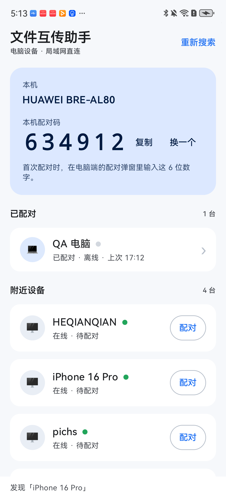
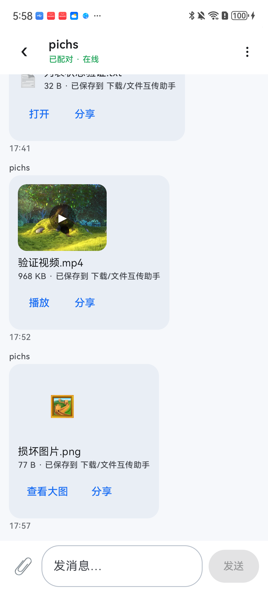
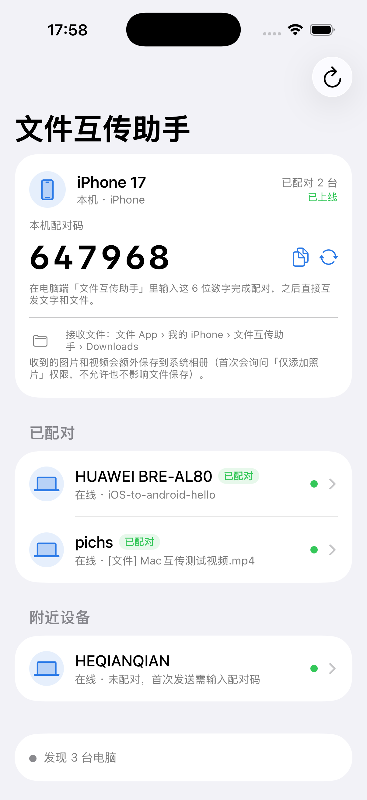
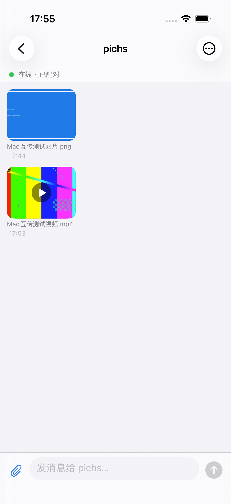
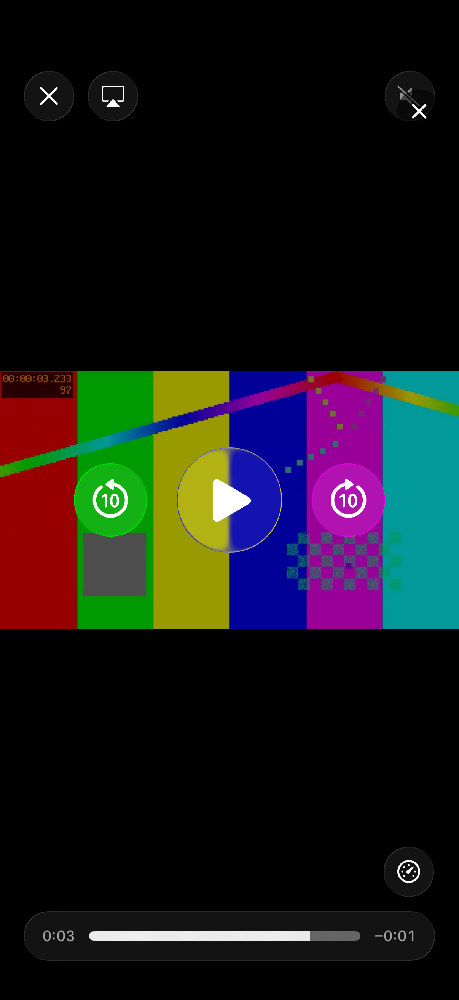

# 文件互传助手 · 移动端（Android / iOS）

<p align="center">
  
  
</p>

> **导航**：[文档中心](../docs/README.md) · [产品与技术](../docs/product-and-tech.md) · [协议规格](../docs/LAN-transfer-spec.md)
>
> 已实现：Android（Kotlin + Jetpack Compose，minSdk 28）与 iOS（SwiftUI，iOS 17+）原生 App。
> 只做「电脑设备」功能：和同一 Wi-Fi 下的 macOS / Windows 电脑发现、配对、互发文字和文件；
> 不做 ADB、USB 调试、手机输入、移动设备页。
>
> 当前版本：**2.2.0**（Android / iOS）。发布包见仓库 [`release/`](../release/)：
> `文件互传助手-Android-2.2.0.apk`（release key 签名）、`文件互传助手-iOS-2.2.0.ipa`（未签名，需自行重签）。

## 截图

| Android 首页 | Android 聊天（图片 / 视频缩略图） |
| --- | --- |
|  |  |

| iOS 首页 | iOS 聊天（缩略图） |
| --- | --- |
|  |  |

iOS 图片全屏查看、视频播放：

| 图片全屏 | 视频播放 |
| --- | --- |
|  |  |

## 平台

| 平台 | 技术 | 最低系统 | Bundle / 包名 |
| --- | --- | --- | --- |
| Android | Kotlin + Jetpack Compose + filepicker | Android 8.0（API 28） | `dev.local.adbtype.mobile` |
| iOS | Swift + SwiftUI + AVKit | iOS 17.0 | `dev.local.adbtype.mobile` |

## 已实现功能

- **发现**：UDP 52730 每 2 秒广播，监听 `0.0.0.0:52730`；8 秒无心跳离线；已配对好友保留，
  对已知设备单播心跳。
- **配对**：本机首页常驻 6 位配对码（可复制 / 换一个）；首次发送弹配对码输入框；已配对 ID
  持久化，之后免配对；配对成功自动继续发送。
- **聊天**：已配对 / 附近设备列表、每设备独立会话、左收右发气泡、时间、中文 / emoji、
  长按复制；离线好友历史可看。
- **文件**：系统文件选择器 / 多选 → 发送 chips；256 KiB 分块、进度、失败清理半截文件；
  重名自动编号、路径穿越拒绝；收到后可打开 / 分享。
- **图片 / 视频**：气泡内固定 120×90 缩略图（视频叠加播放图标）；点击图片全屏放大
  （iOS 支持双指 / 双击缩放），点击视频播放（Android 使用 filepicker 的 `VideoPreviewDialog`，
  iOS 使用 AVKit `AVPlayerViewController`）。
- **存储位置（用户可直接访问）**：
  - Android：公共 `Download/文件互传助手/`，API 29+ 走 `MediaStore.Downloads`，API 28 使用
    公共 Downloads + 存储权限；打开 / 分享使用 MediaStore content URI。
  - iOS：`Documents/Downloads/`，在「文件」App › 我的 iPhone › 文件互传助手 › Downloads 可见；
    图片 / 视频在用户允许「仅添加照片」后额外存入系统相册。
  - 不再把接收文件藏在 App 私有 files 目录。
- **持久化**：设备 ID、`paired.json`、`friends.json`、`chats/<设备ID>.json`，重启恢复；
  每设备最多 500 条，清空只影响当前会话。
- **错误处理**：连接 6s / 读写 30s 超时、对方退出 / Wi-Fi 断开 / 端口占用均有中文提示，不崩溃；
  iOS 本地网络权限被拒有「去设置」引导。

## 与电脑端协议

完全按 [`docs/LAN-transfer-spec.md`](../docs/LAN-transfer-spec.md)：

- 发现：UDP 52730，广播 `{"app":"ADBTypeLink","v":1,"id","name","port"}`；
- 传输：TCP 随机端口，4 字节大端长度 + UTF-8 JSON；文件头后跟原始字节；
- 握手：`hello / hello_ok / pair_required / error`；内容：`text / file` + `ok`，结束 `bye`；
- 6 位配对码、已配对 ID 持久化、256 KiB 文件分块、6s / 30s 超时。

## 目录

```text
mobile/
├─ android/        Kotlin Android App（Gradle）
├─ ios/            SwiftUI iOS App（XcodeGen project.yml）
├─ tests/          Python 协议参考对端与回归测试（开发工具）
├─ assets/         App 图标源图
└─ README.md
```

各平台详细构建/运行说明：

- Android：[`android/README.md`](android/README.md)
- iOS：[`ios/README.md`](ios/README.md)
- 协议测试：[`tests/README.md`](tests/README.md)

## 构建

### Android

```bash
cd mobile/android
JAVA_HOME=/Users/pichs/Library/Java/JavaVirtualMachines/corretto-17.0.19/Contents/Home \
  ./gradlew assembleDebug
# APK: app/build/outputs/apk/debug/app-debug.apk
adb install -r app/build/outputs/apk/debug/app-debug.apk
```

### iOS

```bash
cd mobile/ios
xcodegen generate
xcodebuild -project ADBTypeMobile.xcodeproj -scheme ADBTypeMobile \
  -configuration Debug \
  -destination 'platform=iOS Simulator,name=iPhone 17,OS=26.5' \
  -derivedDataPath build/DerivedData build
```

真机安装需在 Xcode 里配置自己的 Team / 签名；首次运行需允许「本地网络」。

## 测试与真机验证（2026-11-04）

| 项 | 结果 |
| --- | --- |
| Android 构建 / 测试 | `assembleDebug` 成功；78 个 JVM 测试 / 12 类 / 0 失败（含真实 socket 引擎测试） |
| iOS 构建 / 测试 | `xcodebuild test` 成功；49 tests / 0 failures；另有可选 UI 测试 1/1 通过 |
| 手机 ↔ 真实 Mac（pichs） | Android ↔ Mac 文字双向、文件双向；iOS ↔ Mac 图片 / 视频文件真实发送，iOS 落盘 sha256 与 Mac 源一致 |
| 手机 ↔ 手机 | Android 真机 ↔ iPhone 17 模拟器：配对、文字双向通过；缩略图 / 预览 / 播放见各自 README |
| Android 文件落盘 | 公共 `Download/文件互传助手/`，1.2 MB 文件 sha256 一致；重名 ` (2)`；中文 / emoji 文件名、打开 / 分享通过 |
| iOS 文件落盘 | `Documents/Downloads/`，sha256 与 Mac 源一致；图片额外进系统相册；旧 `Received` 自动迁移 |
| Android 图片 / 视频 | 真机缩略图、`ImagePreviewDialog` 放大、`VideoPreviewDialog` 播放通过（filepicker 8.2.0） |
| iOS 图片 / 视频 | 固定 120×90 缩略图、全屏缩放、AVKit 播放通过（XCUITest 截图） |

> 电脑端真机用真实 macOS `pichs` 验证；Windows 端协议一致，但本轮未用 Windows 真机重新配对（需在 Windows 屏幕上读取配对码）。

## 已知限制

- iOS 系统不允许 App 直接写全局「下载」目录；文件放在 App Documents 下并通过「文件」App 暴露，
  图片 / 视频另存系统相册；如需指定其他目录，可后续加 `UIDocumentPicker` 让用户手动选择。
- iOS App 进入后台会被系统挂起，接收消息需保持前台（无后台常驻）。
- Android 无前台服务，长时间后台可能收不到消息；API 28 的公共 Downloads 分支需要存储权限，
  当前只在 API 31 真机上实测。
- 大文件无断点续传；Android content URI 首次视频预览会复制到 cache（系统会回收）。
- 别名字段已按协议读写，但移动端 UI 暂未提供改名入口。
- iOS 真机安装需要开发者 Team / 签名；本次 iOS 验收使用 iPhone 17 / iOS 26.5 模拟器。

