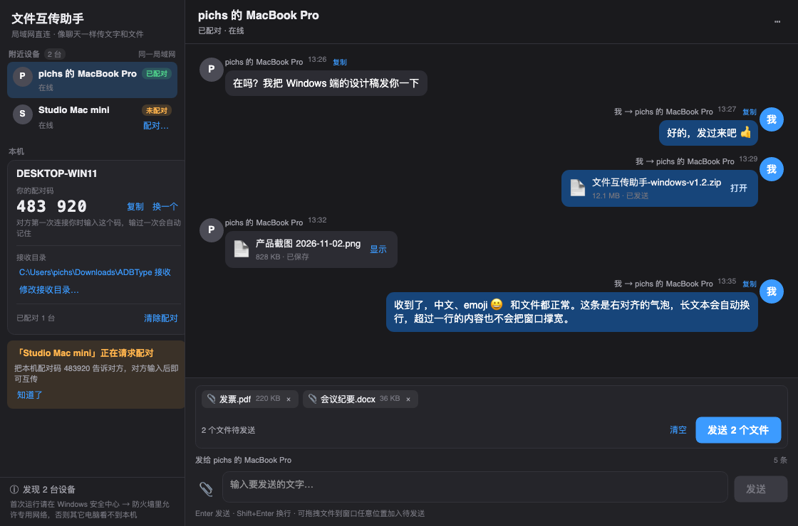

# 文件互传助手 · Windows 端（Avalonia）

Windows 端的「文件互传助手」局域网传输应用：和 macOS 端（`macos/Sources/LANTransfer.swift`）按
[`docs/LAN-transfer-spec.md`](../docs/LAN-transfer-spec.md) 的协议**位对位互通**——互相发现、6 位配对码、
收发文字和文件，界面是微信式的「左边设备列表 + 右边聊天 + 底部固定输入框」。

- 纯 .NET 8（`net8.0`）+ Avalonia 11.3.22，不依赖 WinForms/WPF，核心库可在 macOS/Linux 上编译和测试。
- 无需账号、无服务器、不加密（明文 TCP，仅限可信局域网）。

界面预览（深色 / 浅色）：




---

## 1. 目录结构

```
windows/
├─ ADBTypeLink.sln
├─ build.ps1                       # Windows 构建脚本（Release + win-x64/win-arm64 发布 + 冒烟测试）
├─ src/
│  ├─ ADBTypeLink.Core/            # 跨平台类库：发现 / 协议 / 配对 / 持久化 / 收发
│  ├─ ADBTypeLink.App/             # Avalonia 桌面端（微信式聊天 UI）
│  ├─ ADBTypeLink.SmokeTest/       # 控制台冒烟测试（两个 Core 实例互通）
│  └─ ADBTypeLink.TestPeer/        # 命令行联调端（serve / send），用于和 macOS 端联调
└─ README.md
```

---

## 2. 环境要求

| 用途 | 要求 |
| --- | --- |
| 构建 | .NET 8 SDK（8.0.400+ 即可） |
| 运行（自包含发布） | Windows 10 1809+ / Windows 11，无需单独安装 .NET |
| 运行（框架依赖发布） | Windows 10/11 + .NET 8 Desktop Runtime |

> 当前仓库在 macOS 上用 `$HOME/.dotnet/dotnet` 完成过 restore / build / 冒烟测试 / 界面启动验证。

---

## 3. 构建与发布

### Windows 一键构建（推荐）

```powershell
powershell -ExecutionPolicy Bypass -File .\build.ps1
```

脚本会依次执行：`dotnet restore` → `dotnet build -c Release` → 冒烟测试 → 发布：

- `publish\win-x64\ADBTypeLink.App.exe`（自包含单文件）
- `publish\win-arm64\ADBTypeLink.App.exe`（自包含单文件）
- 两个目录下的 `tools\ADBTypeLink.TestPeer.exe`（联调工具）

常用参数：

```powershell
.\build.ps1 -SkipPublish                 # 只构建
.\build.ps1 -SkipSmokeTest               # 跳过冒烟测试
.\build.ps1 -FrameworkDependent          # 发布框架依赖版本（体积小，目标机需装 .NET 8）
```

### 手动构建

```powershell
dotnet restore ADBTypeLink.sln
dotnet build ADBTypeLink.sln -c Release
dotnet run --project src/ADBTypeLink.SmokeTest -c Release
dotnet run --project src/ADBTypeLink.App -c Release
```

> 在 macOS 上开发调试时同样可以 `dotnet build` / `dotnet run`；数据目录会自动切到
> `~/Library/Application Support/ADBTypeLink`（**不会**读写 macOS 正式端的 `ADBType` 目录）。

---

## 4. 使用说明

1. 两台设备打开应用并连同一个局域网（同一 Wi-Fi / 同一交换机）。
2. 几秒内左侧「附近设备」会出现对方；点设备行选中。
3. **首次发送**需要配对：在对方界面左侧「本机」里看到 6 位配对码，点「配对…」输入（或直接发送时按弹窗提示输入），
   成功后自动记住，以后直接发送。
4. 底部输入框输入文字，`Enter` 发送、`Shift+Enter` 换行；点 📎 选择文件（可多选），文件进入待发送列表（chips），
   再点「发送文件」；也可以把文件直接拖到窗口任意位置。
5. 收到的文件保存在「接收目录」（默认 `%USERPROFILE%\Downloads\ADBType 接收`），重名自动加 `(2)`、`(3)` 序号。
6. 消息区右键文字可「复制文字」，文件卡片可「打开 / 显示」；`⋯` 菜单可清空记录、修改接收目录。

### Windows 防火墙（重要）

首次运行如果其它设备看不到本机：

1. 打开「Windows 安全中心 → 防火墙和网络保护 → 允许应用通过防火墙」；
2. 找到 `ADBTypeLink.App.exe`（或手动「更改设置 → 允许其他应用」添加它），勾选 **专用**；
3. 若网络被识别为「公用网络」，请把当前 Wi-Fi 改成「专用网络」，否则广播会被防火墙丢包。

需要的端口：UDP **52730**（发现，固定端口）+ 应用启动时随机分配的 TCP 端口（传输）。
程序不会申请管理员权限，也不会修改防火墙规则。

---

## 5. 数据与协议

### 本机数据（Windows）

| 内容 | 位置 |
| --- | --- |
| 设备 ID | `%APPDATA%\ADBTypeLink\device.json` |
| 已配对设备 | `%APPDATA%\ADBTypeLink\paired.json`（JSON 字符串数组） |
| 聊天记录 | `%APPDATA%\ADBTypeLink\chat.json`（最多 500 条） |
| 接收目录设置 | `%APPDATA%\ADBTypeLink\settings.json` |
| 默认接收目录 | `%USERPROFILE%\Downloads\ADBType 接收` |

清空聊天记录不会删除已收到的文件。

### 协议要点（详见 spec）

- 发现：UDP 52730，每 2 秒广播 `{"app":"ADBTypeLink","v":1,"id","name","port"}` 到 `255.255.255.255` 与 `127.0.0.1`；8 秒未刷新即从列表移除。
- 传输：TCP，4 字节大端长度 + UTF-8 JSON 帧；单帧上限 16 MiB；文件先发 `file` 头再跟原始字节。
- 握手：`hello / hello_ok / pair_required / error`；内容：`text / file` + `ok`；结束 `bye`。
- 超时：TCP 连接 6 秒，已建连接读写 30 秒。

### 同机多实例的兜底发现

macOS / Windows 的 UDP 语义决定了「多个进程绑定同一端口 + 发往 127.0.0.1 的单播」只会投递给**最后绑定**的那个 socket，
所以仅靠 spec 的回环广播无法让同一台电脑上的两个实例双向发现。程序额外在临时目录写实例心跳文件
（`%TEMP%\ADBTypeLink\instances\*.json`，2 秒刷新、8 秒过期，退出即删除），只用于**本机实例之间**的发现，
不改变任何网络报文，也不影响与 macOS 端的互通。跨设备仍然完全走 UDP 广播。

---

## 6. 联调 / 测试

### 冒烟测试（两个 Core 实例，真实 socket）

```powershell
dotnet run --project src/ADBTypeLink.SmokeTest -c Release
# 跨进程模式（父进程起子进程服务端）
dotnet run --project src/ADBTypeLink.SmokeTest -c Release -- --cross-process
```

覆盖：互相发现、端口正确、未配对提示、配对码配对、已配对免码、长文本（>256 KiB 分帧）、单文件/多文件、
重名自动加序号、0 字节文件发送侧拒绝、空文字拒绝、对端退出连接失败、配对/聊天/设备 ID 持久化与重启恢复。
退出码 `0` 表示全部通过。

### 命令行联调端（和 macOS 端互通）

```powershell
# 接收端：固定配对码 123456，接收目录 D:\recv，跑 120 秒
dotnet run --project src/ADBTypeLink.TestPeer -c Release -- serve --code 123456 --recv-dir D:\recv --name WinProbe

# 发送端：按名称找对端，发文字 + 文件
dotnet run --project src/ADBTypeLink.TestPeer -c Release -- send --peer-name "pichs 的 MacBook Pro" --text "你好" --file .\a.txt --code 123456
```

`serve` 输出 `READY code=... port=...`，收到消息打印 `MSG incoming TEXT ...` / `MSG incoming FILE ...`；
`send` 输出 `RESULT ok` / `RESULT needs-pairing` / `RESULT failure message="..."`。
两者都支持 `--data-dir` 指定独立数据目录（同机跑多个实例时务必分开）。

### 界面截图（无录制权限）

```powershell
dotnet run --project src/ADBTypeLink.App -c Release -- --screenshot out.png --theme light
dotnet run --project src/ADBTypeLink.App -c Release -- --demo        # 用演示数据直接看界面
```

---

## 7. 已知限制

- 明文传输、无加密，仅建议在可信局域网使用；应用不做身份校验之外的安全加固。
- 发送侧拒绝 0 字节文件（按 spec「读不到文件」），接收侧接受 0 字节文件。
- 单文件大小受对端磁盘与 30 秒读写超时限制；超长文件名在 Windows 上会替换非法字符。
- 未做代码签名，Windows 首次运行可能出现 SmartScreen 提示（「更多信息 → 仍要运行」）。
- `win-x64` / `win-arm64` 的自包含单文件发布已在 macOS 上验证可以生成（约 92 MB / 98 MB 的 `ADBTypeLink.App.exe`），但**未在真实 Windows 机器上运行过**；首次在 Windows 上运行建议先 `build.ps1 -SkipPublish` 并用 `dotnet run` 验证。
