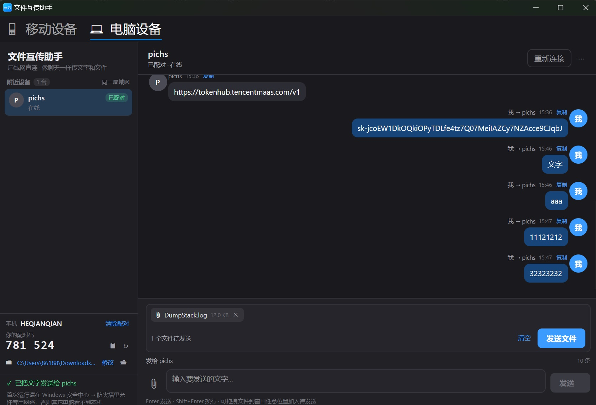
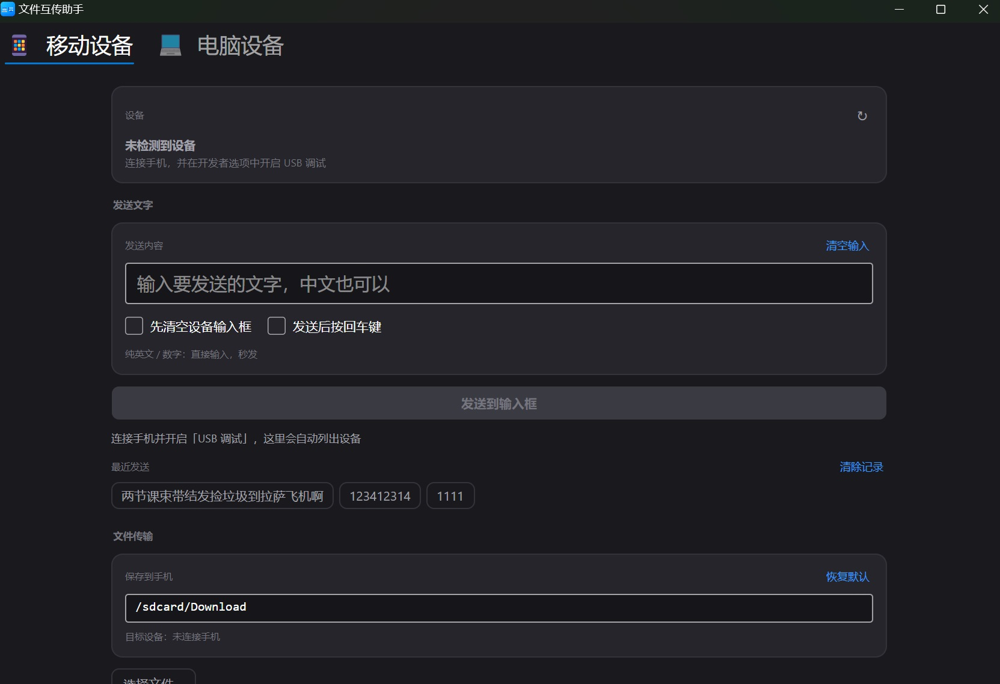
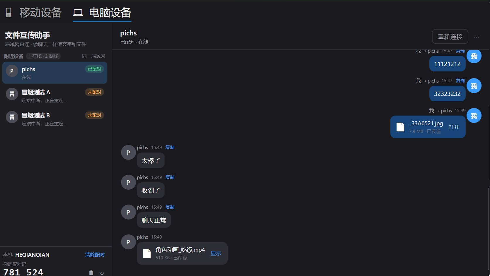

# 文件互传助手 · Windows 端（Avalonia）

Windows 端的「文件互传助手」局域网传输应用：和 macOS 端（`macos/Sources/LANTransfer.swift`）按
[`docs/LAN-transfer-spec.md`](../docs/LAN-transfer-spec.md) 的协议**位对位互通**——互相发现、6 位配对码、
收发文字和文件，界面是微信式的「左边设备列表 + 右边聊天 + 底部固定输入框」。

- 纯 .NET 8（`net8.0`）+ Avalonia 11.3.22，不依赖 WinForms/WPF，核心库可在 macOS/Linux 上编译和测试。
- 无需账号、无服务器、不加密（明文 TCP，仅限可信局域网）。

界面预览：





离线好友仍保留，连接状态单独显示：



---

## 1. 目录结构

```
windows/
├─ ADBTypeLink.sln
├─ build.ps1                       # Windows 构建脚本（Release + win-x64/win-arm64 发布 + 冒烟测试）
├─ build-release.ps1               # 生成 release/ 下的安装包（发布 + NSIS 编译）
├─ installer/setup.nsi             # NSIS 安装程序脚本（向导 / 桌面快捷方式 / 卸载）
├─ src/
│  ├─ ADBTypeLink.Core/            # 跨平台类库：发现 / 协议 / 配对 / 持久化 / 收发
│  ├─ ADBTypeLink.App/             # Avalonia 桌面端（微信式聊天 UI）
│  ├─ ADBTypeLink.SmokeTest/       # 控制台冒烟测试（两个 Core 实例互通）
│  └─ ADBTypeLink.TestPeer/        # 命令行联调端（serve / send），用于和 macOS 端联调
└─ README.md
```

---

## 2. 环境要求

| 用途 | 要求 |
| --- | --- |
| 构建 | .NET 8 SDK（8.0.400+ 即可） |
| 运行（自包含发布） | Windows 10 1809+ / Windows 11，无需单独安装 .NET |
| 运行（框架依赖发布） | Windows 10/11 + .NET 8 Desktop Runtime |

> 当前仓库在 macOS 上用 `$HOME/.dotnet/dotnet` 完成过 restore / build / 冒烟测试 / 界面启动验证。

---

## 3. 构建与发布

### Windows 一键构建（推荐）

```powershell
powershell -ExecutionPolicy Bypass -File .\build.ps1
```

脚本会依次执行：`dotnet restore` → `dotnet build -c Release` → 冒烟测试 → 发布：

- `publish\win-x64\ADBTypeLink.App.exe`（自包含单文件）
- `publish\win-arm64\ADBTypeLink.App.exe`（自包含单文件）
- 两个目录下的 `tools\ADBTypeLink.TestPeer.exe`（联调工具）

常用参数：

```powershell
.\build.ps1 -SkipPublish                 # 只构建
.\build.ps1 -SkipSmokeTest               # 跳过冒烟测试
.\build.ps1 -FrameworkDependent          # 发布框架依赖版本（体积小，目标机需装 .NET 8）
```

### 生成安装包（release/）

```powershell
powershell -ExecutionPolicy Bypass -File .\build-release.ps1
```

脚本先 `dotnet publish` 出 `publish\release-build\` 下的自包含程序
（`ADBTypeLink.App.exe` + `libSkiaSharp.dll` / `av_libglesv2.dll` / `libHarfBuzzSharp.dll`，
原生库随程序放在安装目录，运行时不再解压到 `C:\...\Temp`），再用 NSIS 编译安装程序到仓库根目录：

- `release\文件互传助手-2.0.1-安装包.exe`：带安装向导，安装位置由向导里选择
  （默认 `D:\Program Files\文件互传助手`，向导里随时可以改），
  **完成页有「创建桌面快捷方式」勾选项、默认勾选，点「完成」时才创建**；同时创建开始菜单项和「设置 → 应用」卸载项；
- 只重打安装包（复用现有 exe）：`-SkipBuild`；
- 自定义工具路径：`-Dotnet <dotnet.exe> -Makensis <makensis.exe>`。

安装脚本源码：[`installer/setup.nsi`](installer/setup.nsi)。已测过：安装（勾选 / 取消勾选桌面快捷方式）、
静默安装 `/S`、卸载清理（程序目录 / 开始菜单 / 桌面快捷方式 / 注册表卸载项）。

### 手动构建

```powershell
dotnet restore ADBTypeLink.sln
dotnet build ADBTypeLink.sln -c Release
dotnet run --project src/ADBTypeLink.SmokeTest -c Release
dotnet run --project src/ADBTypeLink.App -c Release
```

> 在 macOS 上开发调试时同样可以 `dotnet build` / `dotnet run`；数据目录会自动切到
> `~/Library/Application Support/ADBTypeLink`（**不会**读写 macOS 正式端的 `ADBType` 目录）。

---

## 4. 使用说明

1. 两台设备打开应用并连同一个局域网（同一 Wi-Fi / 同一交换机）。
2. 几秒内左侧「附近设备」会出现对方；点设备行选中。
3. **首次发送**需要配对：在对方界面左侧「本机」里看到 6 位配对码，点「配对…」输入（或直接发送时按弹窗提示输入），
   成功后自动记住，以后直接发送。
4. 底部输入框输入文字，`Enter` 发送、`Shift+Enter` 换行；点 📎 选择文件（可多选），文件进入待发送列表（chips），
   再点「发送文件」；也可以把文件直接拖到窗口任意位置。
5. 收到的文件保存在「接收目录」（默认 `%USERPROFILE%\Downloads\ADBType 接收`），重名自动加 `(2)`、`(3)` 序号。
6. 消息区右键：文字可「复制文字 / 复制来源与时间」，文件或图片可「打开文件 / 在文件夹中显示 /
   打开接收目录 / 复制文件名 / 复制文件路径」。
   记录里的文件被删掉后，文件名会**加删除线并整体变淡**，右侧注明「文件已删除」；
   这时右键的「打开位置」按 **文件 → 它原来的文件夹 → 设置里的接收目录** 逐级兜底，
   不会出现点了没反应的死路。
   `⋯` 菜单可「设置别名 / 清除全部别名」、清空记录、修改接收目录。
7. 点右上角 `✕`（或按 `Alt+F4`）**不会退出程序**，窗口只是收进**托盘**，后台继续收发文字和文件。
   左键点托盘图标恢复窗口；右键托盘图标可「显示主窗口 / 退出文件互传助手」，
   界面里的 `⋯ → 退出程序` 也能真正退出。

### 移动设备（adb）

窗口顶部有两个页签，和 macOS 端一致：**移动设备** / **电脑设备**（「电脑设备」就是上面那套局域网聊天）。

「移动设备」页通过 adb 直接操作连着的 Android 手机：

| 能力 | 说明 |
| --- | --- |
| 设备列表 | 每 4 秒静默刷新；支持 USB 与无线调试；`unauthorized` / `offline` 会给出中文提示 |
| 发送文字 | 纯 ASCII 走 `input text` 直接输入；含中文 / emoji 自动改为**写入手机剪贴板**（内置 `adbtype-clip.jar`，在手机上长按输入框粘贴） |
| 选项 | 「先清空设备输入框」「发送后按回车键」，只在直接输入模式下生效（剪贴板模式不动手机界面） |
| 最近发送 | 保留最近 12 条，点一下填回输入框，可一键清除 |
| 文件推送 | 选任意数量文件，推到「保存到手机」指定的目录（默认 `/sdcard/Download`），带百分比进度 |

adb 会依次从 `ANDROID_HOME`、`ANDROID_SDK_ROOT`、`%LOCALAPPDATA%\Android\Sdk\platform-tools`、`PATH` 里查找；
找不到时可在页面底部「设置 adb…」手动指定。

> **常见故障：adb 命令超时**
> 如果别的工具（Nox / 逍遥等模拟器、手机助手、QtScrcpy）已经起了自己的 adb 并占着 **5037** 端口，
> 版本与本机 adb 不一致时 `adb shell` / `adb push` 会**直接卡死**，而 `adb devices` 又照常显示设备。
> 页面底部的「重启 adb」按钮会先 `kill-server` 再重新拉起，可以修复这个问题
> （代价是会断开那些工具当前的 adb 连接）。

### Windows 防火墙（重要）

首次运行如果其它设备看不到本机：

1. 打开「Windows 安全中心 → 防火墙和网络保护 → 允许应用通过防火墙」；
2. 找到 `ADBTypeLink.App.exe`（或手动「更改设置 → 允许其他应用」添加它），勾选 **专用**；
3. 若网络被识别为「公用网络」，请把当前 Wi-Fi 改成「专用网络」，否则广播会被防火墙丢包。

需要的端口：UDP **52730**（发现，固定端口）+ 应用启动时随机分配的 TCP 端口（传输）。
程序不会申请管理员权限，也不会修改防火墙规则。

---

## 5. 数据与协议

### 本机数据（Windows）

| 内容 | 位置 |
| --- | --- |
| 设备 ID | `%APPDATA%\ADBTypeLink\device.json` |
| 已配对设备 | `%APPDATA%\ADBTypeLink\paired.json`（JSON 字符串数组） |
| 好友名册 | `%APPDATA%\ADBTypeLink\friends.json`（配对过 / 有过来往的设备，含别名） |
| 聊天记录 | `%APPDATA%\ADBTypeLink\chats\<设备ID>.json`（**每台设备一个文件**，各 500 条） |
| 接收目录设置 | `%APPDATA%\ADBTypeLink\settings.json` |
| 默认接收目录 | `%USERPROFILE%\Downloads\ADBType 接收` |

清空聊天记录只清**当前这台设备**的记录，不会删除已收到的文件。

### 按设备独立缓存

聊天记录按设备分开存，一台设备一个文件，互不串台：

- **切换设备 = 换一份会话**。右上角聊天区永远只显示当前选中那台设备的往来，
  不会把发给别人的内容混进来。
- **离线设备照样在列表里**。只要配对过或者有过消息来往，设备就进了
  `friends.json` 名册；即使它此刻没上线，也显示为「离线 · 上次 12:34」，
  点进去照样能翻历史记录——连接状态不同，不代表设备消失。
- **文件格式与 macOS 端完全一致**（以 macOS 为准）：

  ```jsonc
  // friends.json —— 数组，字段与 Swift 的 StoredFriend 同名
  [{"id":"695DF0EC-...","name":"pichs","host":"172.16.100.144","port":52659,
    "lastSeen":815380862.11,"alias":"办公室的 Mac"}]

  // chats/<设备ID>.json —— 数组，与 Swift 的 LANMessage 同名
  [{"id":"56509d28-...","direction":"incoming","peerName":"pichs",
    "date":815380862.31,"kind":"text","text":"你好"}]
  ```

  - 时间沿用 Swift 的 `Date` 编码：**自 2001-01-01 UTC 起的秒数**（double），不是 ISO 字符串；
  - 消息体里**没有** `peerId`，消息属于谁由文件名决定；
  - 可选字段为空时整个键不出现；文件名只把 `/` `:` 换成 `_`。
  - `alias` 是本地别名，显示时优先于设备名；取消配对时一并清除。
    UI 入口是聊天头部的 `⋯` →「设置别名…」，留空或填回设备名即等于清除。
- **旧数据自动迁移**。老版本的 `chat.json` 会拆到各设备名下，原文件改名
  `chat.json.migrated`；上一版的 `devices.json` 会并进 `friends.json` 并改名
  `devices.json.migrated`。旧消息没有设备 ID，按 `peerName` 归到同名设备，
  对不上号的单独成一份会话，绝不丢数据。


### 协议要点（详见 spec）

- 发现：UDP 52730，每 2 秒广播 `{"app":"ADBTypeLink","v":1,"id","name","port"}` 到 `255.255.255.255`、`127.0.0.1`
  以及**每块网卡各自的子网定向广播地址**（如 `172.16.101.255`）；**60 秒**未刷新才从列表移除（原来 18 秒就删，Wi-Fi 抖一下设备就凭空消失，选都选不中）。
  界面上超过 6 秒没收到广播就显示「连接中断，正在重连…」，而不是让设备凭空消失。

在线状态分三层，不再是一句写死的「在线」：

| 现象 | 界面显示 |
| --- | --- |
| 6 秒内收到过广播 | 在线 |
| 超过 6 秒没广播 | 连接中断，正在重连… |
| TCP 探活成功 | 立刻回到「在线」（UDP 丢包但链路其实是通的） |
- 传输：TCP，4 字节大端长度 + UTF-8 JSON 帧；单帧上限 16 MiB；文件先发 `file` 头再跟原始字节。
- 握手：`hello / hello_ok / pair_required / error`；内容：`text / file` + `ok`；结束 `bye`。
- 超时：TCP 单次连接尝试 2 秒、一次发送动作最多 4 秒建连预算（含自动重试）；控制帧读写 15 秒，
  文件数据块读写 90 秒。已连接的 socket 开启 TCP keepalive（15 秒探测、5 秒间隔、3 次），
  Wi-Fi 掉线造成的半开连接能被及时发现。
- 抗抖动：连接或握手阶段掉线会**自动重连重发一轮**；一次发送动作里的多个文件**复用同一条连接**。
- **按文件重传**：实测 20 MB 文件会传到 97% 左右被对端断开（Wi-Fi 抖动 / 对端收完即关连接），
  所以断连后不是整批失败，而是**重连并从该文件重传**，单个文件最多 3 次（`LinkProtocol.FileAttempts`）。
  失败文案会精确到字节，例如「传到 524288/8388608 字节时连接被对方关闭」，
  而不是笼统的「网络中断」。
  配对码错误、协议不匹配这类重试无用的失败立即返回，不会让用户白等。
- **手动重连**：聊天区右上角「重新连接」，立刻对选中设备做一次 TCP 探活。
  只建立连接、不发 hello，所以**不会在对方屏幕上弹出配对提示**。
- **自动重连**：选中设备显示「连接中断」时，后台每 5 秒探活一次，通了自动改回「在线」。
- **发送进度与取消**：发送时输入框上方显示「正在发送 2/3 报告.pdf」+ 百分比 + 进度条，
  右边的 **✕** 随时中断。取消后接收端不会留下半截文件，链路可以立刻继续用。
- **失败可见**：发送失败会在输入框上方弹出红色横幅写明原因
  （以前只写在角落的状态行，很容易被当成「点了没反应」），点 ✕ 关掉。
- **运行日志**：右上角 ⋯ →「打开运行日志…」，路径 `%APPDATA%\ADBTypeLink\app.log`
  （超过 2 MB 自动滚动成 `app.log.1`）。反馈问题时把这个文件带上。

### 同机多实例的兜底发现

macOS / Windows 的 UDP 语义决定了「多个进程绑定同一端口 + 发往 127.0.0.1 的单播」只会投递给**最后绑定**的那个 socket，
所以仅靠 spec 的回环广播无法让同一台电脑上的两个实例双向发现。程序额外在临时目录写实例心跳文件
（`%TEMP%\ADBTypeLink\instances\*.json`，2 秒刷新、8 秒过期，退出即删除；这个 8 秒与网络侧无关），只用于**本机实例之间**的发现，
不改变任何网络报文，也不影响与 macOS 端的互通。跨设备仍然完全走 UDP 广播。

---

## 6. 联调 / 测试

完整的 Windows 真机测试步骤、界面检查项和双机联调清单见 [`TESTING.md`](TESTING.md)。

### 冒烟测试（两个 Core 实例，真实 socket）

```powershell
dotnet run --project src/ADBTypeLink.SmokeTest -c Release
# 跨进程模式（父进程起子进程服务端）
dotnet run --project src/ADBTypeLink.SmokeTest -c Release -- --cross-process
```

覆盖：互相发现、端口正确、未配对提示、配对码配对、已配对免码、长文本（>256 KiB 分帧）、单文件/多文件、
重名自动加序号、0 字节文件发送侧拒绝、空文字拒绝、对端退出连接失败、配对/聊天/设备 ID 持久化与重启恢复。
退出码 `0` 表示全部通过。

### 命令行联调端（和 macOS 端互通）

```powershell
# 接收端：固定配对码 123456，接收目录 D:\recv，跑 120 秒
dotnet run --project src/ADBTypeLink.TestPeer -c Release -- serve --code 123456 --recv-dir D:\recv --name WinProbe

# 发送端：按名称找对端，发文字 + 文件
dotnet run --project src/ADBTypeLink.TestPeer -c Release -- send --peer-name "pichs 的 MacBook Pro" --text "你好" --file .\a.txt --code 123456
```

`serve` 输出 `READY code=... port=...`，收到消息打印 `MSG incoming TEXT ...` / `MSG incoming FILE ...`；
`send` 输出 `RESULT ok` / `RESULT needs-pairing` / `RESULT failure message="..."`。
两者都支持 `--data-dir` 指定独立数据目录（同机跑多个实例时务必分开）。

### 界面截图（无录制权限）

```powershell
dotnet run --project src/ADBTypeLink.App -c Release -- --screenshot out.png --theme light
dotnet run --project src/ADBTypeLink.App -c Release -- --demo        # 用演示数据直接看界面
```

---

## 7. 已知限制

- 明文传输、无加密，仅建议在可信局域网使用；应用不做身份校验之外的安全加固。
- 发送侧拒绝 0 字节文件（按 spec「读不到文件」），接收侧接受 0 字节文件。
- 单文件大小受对端磁盘与 90 秒数据块读写超时限制；超长文件名在 Windows 上会替换非法字符。
- 未做代码签名，Windows 首次运行可能出现 SmartScreen 提示（「更多信息 → 仍要运行」）。
- `win-x64` / `win-arm64` 的自包含单文件发布已在 macOS 上验证可以生成（约 92 MB / 98 MB 的 `ADBTypeLink.App.exe`）；
  Windows 真机上已完成安装包（安装 / 桌面快捷方式 / 静默安装 / 卸载）验证，应用界面细节与双机互传
  仍建议按 [`TESTING.md`](TESTING.md) 点一遍。
